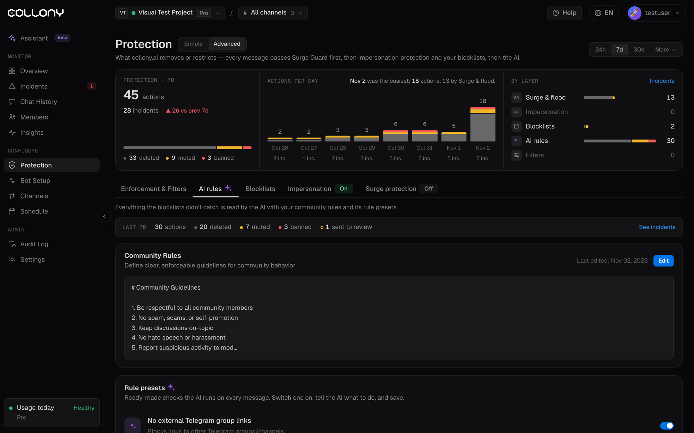

Everything the blocklists did not catch is read by the AI, with your community rules and its rule presets. Open this from the **AI rules** tab on the [Protection](/protection) page, in the Advanced view. In the Simple view, the same presets sit under **Scam and spam rules**, with **Customize** on each one and **Edit community rules** for your own rules.

<Note>
  AI rules are part of the Protect, Grow and Scale plans. See [Billing](/billing).
</Note>

The top of the tab shows what the AI did in the last 7 days: actions, deletions, mutes, bans and cases sent to review, with a link to the matching incidents.

<Frame>
  
</Frame>

## Community rules

Plain-language rules that say what is allowed and what gets removed. Click **Edit**, paste your rules and save. The AI applies them right away. Every edit is versioned, and the page shows who edited the rules last.

The bot already knows your project from [Bot Setup](/bot-setup), so these rules can say "the team" and "official channels" and still enforce correctly. Pick the closest template, paste it in, and adjust only what is specific to your community.

<Tabs>
  <Tab title="General">
    ```txt
    INSTANT BAN:
    - Phishing, scam links, or any link promising free money, prizes, or giveaways
    - Impersonating the team, moderators, or support, including lookalike names and avatars
    - Anyone offering to DM, "help," "verify," or "sync" anything on the team's behalf
    - Posting other members' personal information without consent
    - Unsolicited promotion of other projects, products, services, or invite links
    - Mass-tagging, raid behavior, or coordinated spam

    WARN, THEN MUTE, THEN BAN:
    - Repeated off-topic posting after being asked to stop
    - Self-promotion outside designated channels
    - Emoji, sticker, or copy-paste flooding
    - Persistent bad-faith arguing or thread derailment

    ALLOWED, DO NOT ACT ON:
    - Honest criticism, complaints, or negative sentiment about the project
    - Comparisons to competitors and general market or industry talk
    - Heated but good-faith debate between members
    - Questions that have been asked before

    ENFORCEMENT:
    - Severe violations (scams, phishing, impersonation) skip straight to ban
    - Standard violations follow warn to mute to ban
    - When unsure, remove the message and flag an admin rather than banning
    ```
  </Tab>
  <Tab title="Crypto">
    ```txt
    INSTANT BAN:
    - Airdrop, claim, mint, presale, or "check eligibility" links from anyone but a verified admin
    - "Send your wallet," "first X wallets," "claim your tokens here," or any giveaway hook
    - DM-first contact offering to help, verify, sync, validate, or recover a wallet
    - Seed phrase, private key, or "connect wallet" prompts in any form
    - Posting contract addresses or claim links that don't match official, pinned sources
    - Impersonating the team, mods, or support, including lookalike handles and avatars
    - Unsolicited promotion of other tokens, projects, or P2P/OTC trades

    WARN, THEN MUTE, THEN BAN:
    - Spam, flooding, or repeated off-topic posting
    - Coordinated or baseless FUD after it's been addressed once with facts
    - Self-promotion outside designated channels

    ALLOWED, DO NOT ACT ON:
    - Price discussion, criticism, and negative sentiment
    - Tokenomics, unlock, and allocation complaints
    - Competitor and broader market talk
    - Technical debate and good-faith questions

    ENFORCEMENT:
    - Scams, phishing, and wallet-drain attempts are immediate bans, no warning
    - The team NEVER DMs first. Treat anyone who does as a scammer
    - When unsure about a link or address, remove it and flag an admin
    ```
  </Tab>
  <Tab title="Gaming">
    ```txt
    INSTANT BAN:
    - Cheats, hacks, exploits, or links to them
    - Threats, doxxing, or sharing another player's personal information
    - Phishing, scam links, fake giveaways, or free-skin/free-currency bait
    - Impersonating developers, mods, or official support
    - Slurs, hate speech, or targeted harassment campaigns

    WARN, THEN MUTE, THEN BAN:
    - Trash talk that tips into personal, targeted harassment
    - Untagged spoilers
    - Spamming server invites or self-promo outside designated channels
    - Flooding, emoji/sticker spam, or off-topic derailment

    ALLOWED, DO NOT ACT ON:
    - Game criticism, negative reviews, and balance complaints
    - Competitor game discussion
    - Memes, banter, and competitive smack talk between willing players
    - Content creators sharing their own work once per post

    ENFORCEMENT:
    - Cheating, doxxing, and hate speech skip to immediate ban
    - Keep the competitive culture intact, don't over-moderate normal banter
    - When unsure, mute and flag an admin rather than banning
    ```
  </Tab>
  <Tab title="Sports betting">
    ```txt
    INSTANT BAN:
    - Paid tipster services, "guaranteed win" claims, or signal-selling
    - Phishing, scam links, or impersonating the platform, team, or support
    - Affiliate or referral links dropped without permission
    - Anyone offering to DM "locks," "fixed games," or insider picks
    - Threats, doxxing, or targeted harassment

    WARN, THEN MUTE, THEN BAN:
    - Spam, flooding, or repeated off-topic posting
    - Promoting rival betting platforms or books
    - Tilt-venting that turns into abuse of other members
    - Self-promotion outside designated channels

    ALLOWED, DO NOT ACT ON:
    - Picks, predictions, analysis, and bet discussion
    - Criticism of odds, lines, results, or platform decisions
    - General sports talk, banter, and rivalries
    - Responsible-gambling conversation and support

    ENFORCEMENT:
    - Scams, fixed-game claims, and tipster spam are immediate bans
    - Don't moderate normal losing-streak frustration, only act when it targets people
    - When unsure, remove the message and flag an admin
    ```
  </Tab>
</Tabs>

## Rule presets

Ready-made checks the AI runs on every message, next to your community rules. Each one is tuned by collony.ai for a common attack. Switch one on, tell the AI what to do, and save.

| Preset | What it catches |
| --- | --- |
| **No external Telegram group links** | Links to other Telegram groups or channels |
| **Remove random bot tags** | The random bot-tagging tactic on Telegram |
| **No random crypto addresses** | Unsolicited wallet addresses |
| **Bypass prevention** | Attempts to bait the bot or dodge moderation, including quoted or forwarded scam content |
| **Sexual & thirst-trap bots** | Heart-emoji openers, forwarded romantic messages, sex-bot conversation starters |
| **DM solicitation & off-platform promotion** | DM begging, channel and bio promotion, signal-service ads, ROI and percent promotion. Softer action by default. |
| **Recruitment & get-rich-quick spam** | Job pitches, earn-online schemes, copy-trading brags |
| **Impersonation Check** | Users pretending to be moderators or admins |
| **Scams, phishing & impersonation** | Phishing, "send X get 2X" doubling, staff impersonation, P2P USDT solicitation |
| **Enforce allowed language(s)** | Restricts the chat to the languages you pick (English, Spanish or custom) |

### Preset options

Each preset has three settings:

- **Tell the AI to**: delete, mute, ban or decide by itself. With **decide by itself**, the AI picks the action based on severity. If the bot is not allowed to ban, a ban becomes a ban suggestion. See [Enforcement and filters](/enforcement#allow-bot-to-ban).
- **Applies on**: Discord, Telegram or both.
- **Custom instruction** (optional): an extra line for edge cases, for example `Ban if the user also swears`.

Click **Save all rules** after you make changes. Unsaved changes are flagged on the page.

<Tip>
  If the Impersonation Check flags your own team, make sure they have the Moderator or Admin role in [Members](/members). The check uses roles to tell real admins from imposters.
</Tip>
