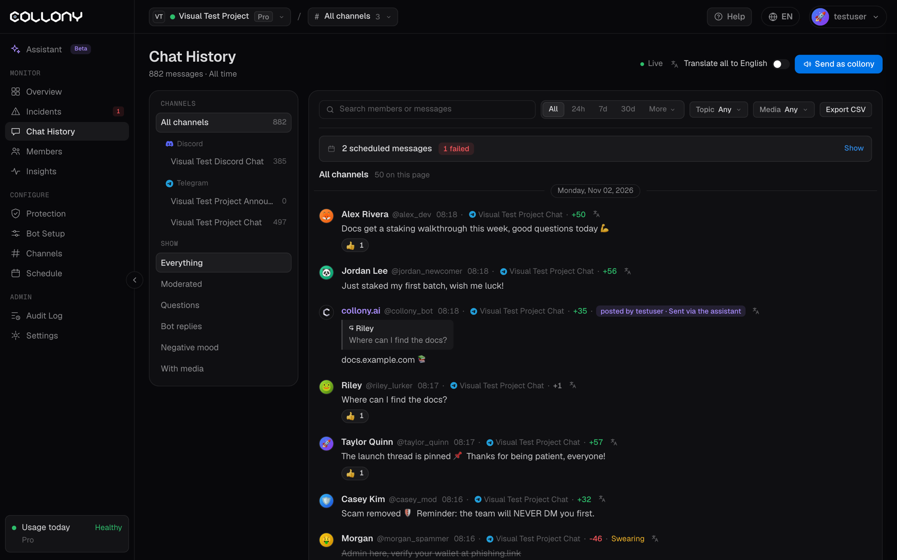

Chat History is a live, searchable feed of every message collony.ai has seen in the current project. Each message carries its mood score and topic labels, and you can act on it without leaving the page.

<Frame>
  
</Frame>

## Live feed

The feed refreshes on its own. It pauses while the tab is hidden and shows when it is retrying. **Translate all to English** translates the whole feed.

## Filters

| Filter | Options |
| --- | --- |
| **Channels** | All channels, or one channel, grouped by Discord and Telegram, with message counts |
| **Show** | Everything, Moderated, Questions, Bot replies, Negative mood, With media |
| **Range** | All time, 24h, 7d, 30d, or **More** for presets or a custom From and To |
| **Topic** | Question, Technical, Social, Meme, Shilling, FUD, Sarcastic, Swearing |
| **Media** | Photo, Video, GIF, Document, Voice, Audio, Sticker, Forward, Contact, Poll, Location, Story |

Use the search box to find a member or message text. Click **Export CSV** to download what you filtered.

## Message actions

Open the menu on any message to:

- **Open message** for its [detail page](/message)
- **Open on Telegram** or Discord
- **Copy link** or **Copy text**
- **View member** to open their [profile](/member-details)
- **Mute** for 24 hours (default), 1 hour or 7 days
- **Ban** the sender
- **Delete message**

Expand a message to see its labels and reactions.

<Warning>
  Actions from the app take effect in the community right away.
</Warning>

## Send as collony

Click **Send as collony** to post a message as the bot in a channel, now or at a set time.

Scheduled and recent sent messages show above the feed: the channel, the time, who sent it and how (from the app, the [Assistant](/assistant) or an [AI app](/ai-apps)). Edit or cancel a scheduled message. If a message failed, for example because the bot was removed from the chat, the error shows and you can click **Send again**.
