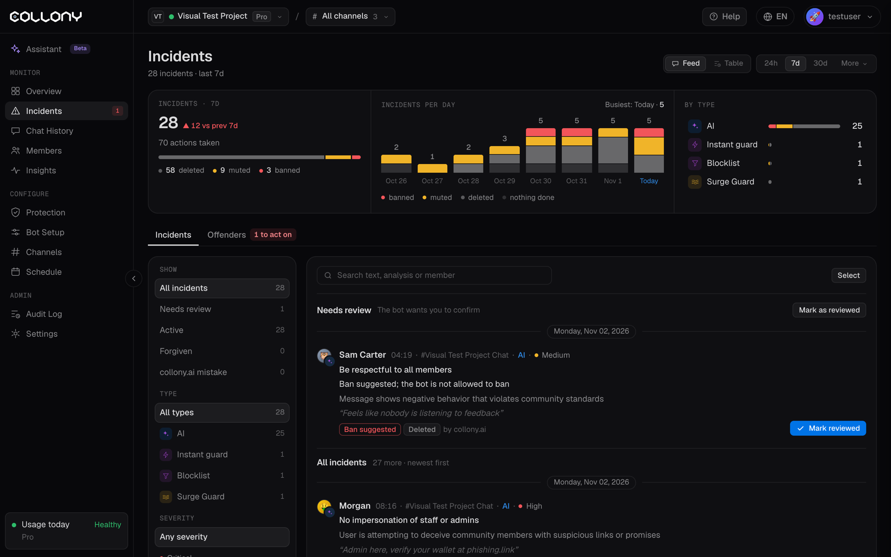

La página Incidentes muestra cada caso de moderación del proyecto actual, del bot o de tu equipo. Úsala para revisar las decisiones del bot, atender los casos que te marcó y ocuparte de los reincidentes.

Elige el periodo arriba: 24h, 7d, 30d, o **Más** para otras opciones o un rango personalizado. Cambia entre una vista de **Feed** con tarjetas y una **Tabla**.

<Frame>
  
</Frame>

## Resumen

- Incidentes y acciones tomadas, con el cambio respecto al periodo anterior
- Totales de eliminados, silenciados y baneados
- **Incidentes por día**, coloreados según lo que se hizo: baneo, silencio, eliminación o nada
- **Por tipo**: qué detectó cada caso, como la IA, el Instant guard, una lista de bloqueo o Surge Guard, con sus eliminaciones, silencios y baneos

## Pestaña Incidentes

### Filtros

| Filtro | Opciones |
| --- | --- |
| **Mostrar** | Todos los incidentes, Pendiente de revisión, Activos, Perdonados, Error de collony.ai |
| **Tipo** | IA, Instant guard, Lista de bloqueo, Surge Guard y las demás capas que actuaron en el periodo |
| **Gravedad** | Crítica, Alta, Media, Baja |

### Pendiente de revisión

Los casos que el bot quiere que confirmes, arriba de la lista. Por ejemplo, una **sugerencia de baneo** cuando el bot no puede banear solo (consulta [Aplicación y filtros](/es/enforcement)), o un mensaje marcado por una lista de bloqueo o por la revisión de suplantación.

Cada tarjeta muestra el miembro, el canal, qué lo detectó, la regla que incumplió, el motivo del bot, el mensaje y lo que se hizo. Usa **Marcar como revisado** cuando el bot acertó, o abre el menú para actuar. Selecciona varias tarjetas para marcarlas como revisadas a la vez.

### Acciones sobre un incidente

| Acción | Qué hace |
| --- | --- |
| **Banear, como sugiere el bot** | Expulsa al miembro, como sugirió el bot |
| **Marcar como revisado** | El bot acertó. No cambia nada. |
| **Perdonar** | Deshace lo hecho y quita el silencio o el baneo. El incidente deja de contar para los [baneos por reincidencia](/es/enforcement). |
| **Marcar como error** | Lo deshace todo y enseña a collony.ai a no repetirlo. Puedes describir qué salió mal. |

El menú también permite silenciar, eliminar el mensaje y abrir el incidente, el mensaje o el miembro.

También puedes perdonar y marcar errores desde el chat con `/forgive` y `/fp`. Consulta [Comandos del chat](/es/chat-commands).

## Pestaña Infractores

Los miembros agrupados por sus incidentes en el periodo, con su número de incidentes, el último incidente, su estado actual y lo que sugiere el bot, por ejemplo **Banear (lo pidió el bot)**. Actúa desde la fila: abrir el miembro, silenciar, banear o añadir a la lista blanca. Los miembros baneados se ocultan salvo que elijas mostrarlos.

## Página del incidente

Haz clic en **Abrir incidente** para ver el caso completo:

- **El mensaje** y su puntuación de ánimo, con traducir y abrir en Telegram o Discord
- **Qué pasó**: cada revisión que saltó, con su puntuación
- **Contexto del chat**: los mensajes de antes y de después
- **Cronología**: cuándo se envió el mensaje y cada acción del bot, con sus tiempos
- **Incidente**: estado, gravedad, qué lo detectó, la regla y el motivo del bot
- **Análisis de collony AI**: puntuaciones de incumplimiento de reglas y de malicia
- **Usuario**: el historial del miembro, su estado y sus roles, con botones rápidos de rol

El menú **Acciones** silencia, banea, elimina mensajes recientes o abre el perfil del miembro.
