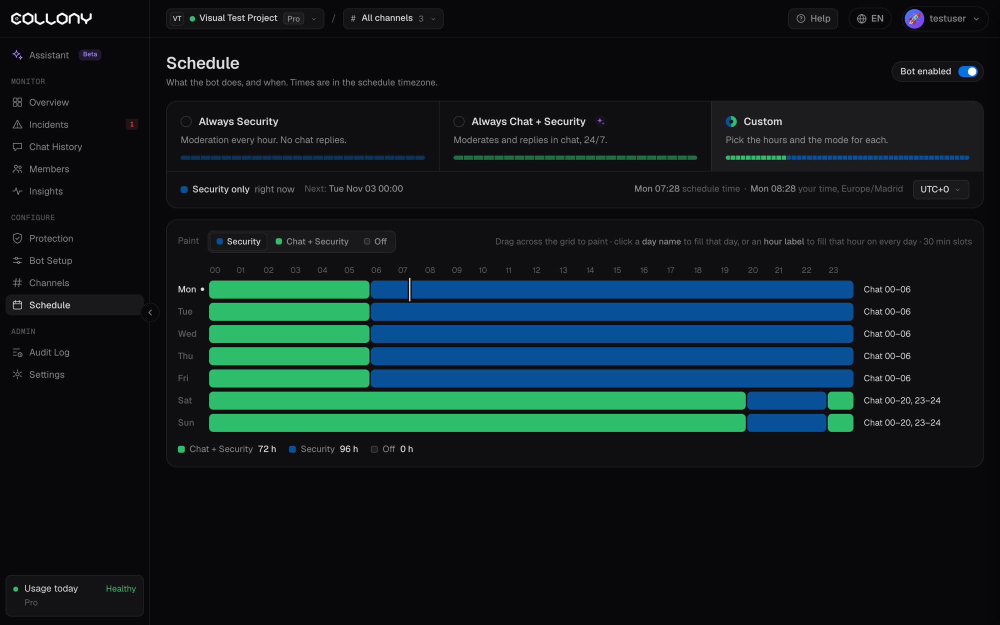

La página Horario define qué hace el bot y cuándo. Úsala para moderar las 24 horas y limitar las respuestas en el chat a las horas en que tu comunidad está más activa.

<Frame>
  
</Frame>

## Bot activado

El interruptor principal. Si está apagado, el bot no hace nada, diga lo que diga el horario.

## Elige un horario

| Opción | Qué hace el bot |
| --- | --- |
| **Siempre Seguridad** | Modera a todas horas, todos los días, sin responder en el chat |
| **Siempre Chat + Seguridad** | Modera y responde en el chat, 24/7 |
| **Personalizado** | Eliges las horas y el modo de cada una |

La página muestra el modo actual y cuándo será el próximo cambio.

## Zona horaria

Las horas se muestran en la zona horaria del horario. Elige la tuya en la lista, de UTC-10 (Honolulu) a UTC+12 (Auckland), para que la cuadrícula coincida con el día de tu comunidad.

## Horario personalizado

Elige un modo para pintar y pinta la cuadrícula semanal:

| Modo | Qué hace el bot |
| --- | --- |
| **Seguridad** | Modera, pero no responde ni se une a la conversación |
| **Chat + Seguridad** | Modera y responde: chat, respuestas de FAQ y reacciones |
| **Apagado** | No hace nada en esa franja |

1. Arrastra sobre la cuadrícula para pintar franjas de 30 minutos.
2. Haz clic en el nombre de un día para llenarlo entero, o en una hora para llenar esa hora en todos los días.
3. Haz clic en **Guardar cambios**, o en **Descartar** para deshacerlos.

<Tip>
  Una configuración habitual: Chat + Seguridad en las horas de más actividad y Seguridad el resto del tiempo. Las estafas se siguen eliminando 24/7 y el bot solo conversa cuando hay gente.
</Tip>
