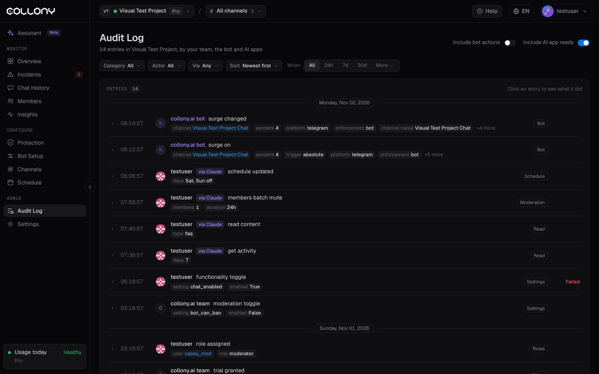

Le journal d'audit enregistre chaque modification du projet : par votre équipe, par le bot et par les [apps IA](/fr/ai-apps). Utilisez-le pour savoir qui a changé quoi et quand.

<Frame>
  
</Frame>

## Filtres

| Filtre | Options |
| --- | --- |
| **Inclure les actions du bot** | Affiche ce que le bot a fait de lui-même, comme activer Surge Guard |
| **Inclure les lectures des apps IA** | Affiche ce que les apps IA ont lu, pas seulement ce qu'elles ont changé |
| **Catégorie** | Toutes, Facturation, Contenu, Modération, Lecture, Rôles, Planning, Paramètres |
| **Auteur** | Toutes les personnes ayant fait une modification, y compris l'équipe collony.ai |
| **Via** | Tous, ou les apps IA uniquement |
| **Quand** | Depuis le début, 24h, 7j, 30j, ou **Plus** pour d'autres options ou une plage personnalisée |
| **Tri** | Les plus récents ou les plus anciens d'abord |

## Entrées

Chaque entrée indique l'heure, l'auteur, l'action, la cible (un utilisateur, un canal, un réglage ou un contenu), les détails et si elle a réussi. Cliquez sur une entrée pour voir tout ce qu'elle a fait, y compris l'erreur en cas d'échec.

Les modifications faites via une app IA sont marquées avec l'app, par exemple "via Claude (AI app)". Cliquez sur **Annuler cette modification** pour la revenir en arrière.

Exemples de ce qui est enregistré :

- Rôles ajoutés ou retirés
- Modifications du planning, des paramètres et de la protection
- Contenu enregistré dans la [Configuration du bot](/fr/bot-setup)
- Mises en sourdine, bannissements et autres actions de modération
- Activation ou modification de Surge Guard par le bot

<Tip>
  Si le bot se met à se comporter différemment, filtrez d'abord par **Contenu** ou **Paramètres**. Une modification récente de la personnalité de l'agent ou de la base de connaissances en est souvent la cause.
</Tip>
