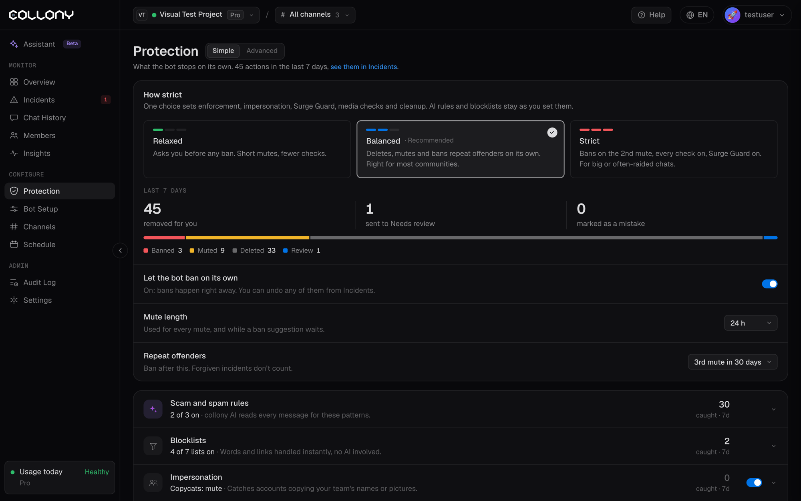

La page Protection contrôle ce que le bot bloque de lui-même. Ouvrez-la depuis **Protection** dans la barre latérale. Elle a deux vues, **Simple** et **Avancée**. Passez de l'une à l'autre en haut de la page.

<Frame>
  
</Frame>

## Vue Simple

### Niveau de rigueur

Un seul choix règle à la fois les sanctions, l'usurpation, Surge Guard, la vérification des médias et le nettoyage. Vos règles IA et vos listes de blocage restent telles que vous les avez définies.

| Niveau | Effet |
| --- | --- |
| **Détendu** | Vous demande avant tout bannissement. Mises en sourdine courtes, moins de vérifications. |
| **Équilibré** (recommandé) | Supprime, met en sourdine et bannit les récidivistes de lui-même. Adapté à la plupart des communautés. |
| **Strict** | Bannit à la 2e mise en sourdine, toutes les vérifications actives, Surge Guard activé. Pour les grands chats ou ceux souvent attaqués. |

### 7 derniers jours

Combien de messages le bot a supprimés pour vous, combien il a envoyés en **À vérifier** et combien vous avez marqués comme erreur. La barre les répartit entre bannis, mis en sourdine, supprimés et à vérifier.

### Réglages rapides

- **Laisser le bot bannir seul** : activé, les bannissements sont immédiats et vous pouvez annuler n'importe lequel depuis [Incidents](/fr/incidents). Désactivé, le bot suggère le bannissement et vous attend.
- **Durée de mise en sourdine** : utilisée pour chaque mise en sourdine et pendant qu'une suggestion de bannissement attend. 1 heure, 24 heures, 3 jours ou 7 jours.
- **Récidivistes** : quand bannir, par exemple à la 3e mise en sourdine en 30 jours, ou jamais. Les incidents pardonnés ne comptent pas.

### Couches

Sous les réglages rapides, chaque couche de protection est une ligne que vous pouvez ouvrir. Chacune indique combien de messages elle a interceptés ces 7 derniers jours.

| Couche | Ce qu'elle couvre |
| --- | --- |
| **Règles anti-arnaques et spam** | L'IA lit chaque message à la recherche de ces schémas, en plus de vos règles de communauté. Voir [Règles IA](/fr/ai-rules). |
| **Listes de blocage** | Mots et liens traités instantanément, sans IA. Voir [Listes de blocage](/fr/blocklists). |
| **Usurpation** | Repère les comptes qui copient les noms ou les photos de votre équipe. Voir [Usurpation](/fr/impersonation). |
| **Surge Guard** | Mode lent automatique pendant les afflux et les raids. Voir [Surge Guard](/fr/surge-guard). |

Ouvrez une ligne pour modifier ses principaux réglages. **Plus dans Avancée** vous mène à tous les réglages.

## Vue Avancée

La vue Avancée affiche tous les réglages et tous les chiffres.

### Comment un message est vérifié

Chaque message passe par les couches dans cet ordre. La première couche qui agit sur un message décide de son sort.

<Steps>
  <Step title="Surge Guard">
    Surveille le rythme des messages dans chaque canal et active le mode lent pendant un afflux ou un raid.
  </Step>
  <Step title="Protection contre l'usurpation">
    Repère les membres qui copient le nom, l'@identifiant ou la photo d'une personne de votre équipe.
  </Step>
  <Step title="Listes de blocage">
    Mots, expressions et domaines, traités instantanément.
  </Step>
  <Step title="Règles IA">
    Tout ce que les couches précédentes n'ont pas intercepté est lu par l'IA, avec vos règles de communauté et les règles prédéfinies.
  </Step>
</Steps>

### Activité

Pour la période choisie (24h, 7j, 30j, ou **Plus** pour des options comme les 14 derniers jours, ce mois-ci ou une plage personnalisée) :

- Actions et incidents, avec l'évolution par rapport à la période précédente
- Nombre de suppressions, de mises en sourdine et de bannissements
- **Actions par jour**, avec le jour le plus chargé et la couche qui a le plus travaillé
- **Par couche** : afflux et flood, usurpation, listes de blocage, règles IA et filtres, chacune avec ses suppressions, mises en sourdine et bannissements

### Onglets

<Columns cols={2}>
  <Card title="Sanctions et filtres" href="/fr/enforcement">
    Droits de bannissement, durée de mise en sourdine, récidivistes, médias et nettoyage.
  </Card>
  <Card title="Règles IA" href="/fr/ai-rules">
    Vos règles de communauté et les règles prédéfinies.
  </Card>
  <Card title="Listes de blocage" href="/fr/blocklists">
    Domaines bloqués et autorisés, et collections de blocage.
  </Card>
  <Card title="Usurpation" href="/fr/impersonation">
    Ce qui compte comme copie et ce qui lui arrive.
  </Card>
  <Card title="Surge Guard" href="/fr/surge-guard">
    Déclencheurs et mode lent contre les afflux et les raids.
  </Card>
</Columns>
