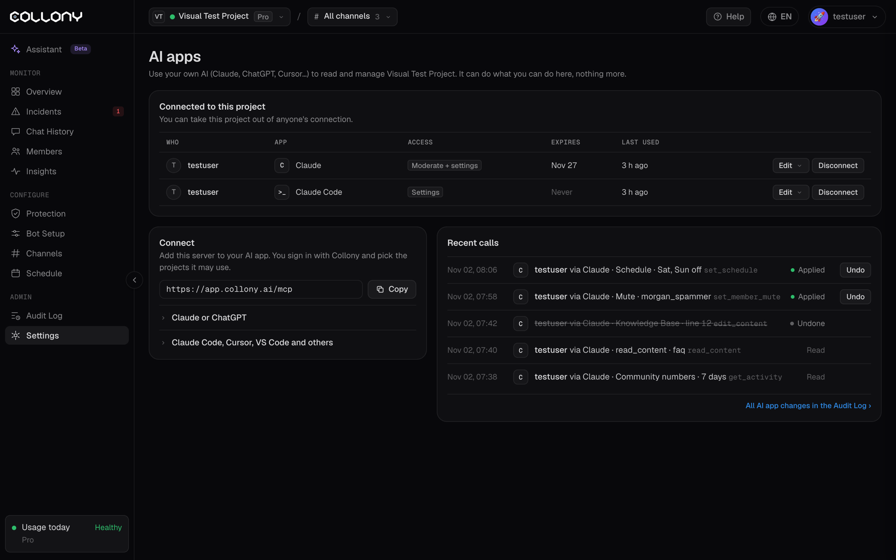

अपने AI को collony.ai से कनेक्ट करें और अपनी कम्युनिटी को आम भाषा में मैनेज करें। पूछें "इस हफ़्ते चैट में क्या हुआ?", "एयरड्रॉप लिंक पोस्ट करने वाले अकाउंट को म्यूट करो" या "वीकेंड पर चैट जवाब बंद करो", और आपका AI यह आपके लिए कर देगा।

यह collony.ai MCP सर्वर के ज़रिए काम करता है, और सिर्फ़ वही कर सकता है जो आप ऐप में कर सकते हैं।

<Frame>
  
</Frame>

## शुरू करने से पहले

आपको चाहिए:

- कम से कम एक प्रोजेक्ट की एक्सेस वाला collony.ai अकाउंट
- इनमें से एक: Claude, ChatGPT, Claude Code, Cursor या VS Code
- सर्वर URL:

```text
https://app.collony.ai/mcp
```

आप इसे ऐप में **सेटिंग्स** और फिर **AI ऐप कनेक्ट या मैनेज करें** से भी कॉपी कर सकते हैं।

## अपना AI ऐप कनेक्ट करें

अपना ऐप चुनें और कदमों का पालन करें।

<Tabs>
  <Tab title="Claude">
    <Steps>
      <Step title="Connectors खोलें">
        Claude में **Settings**, फिर **Connectors** पर जाएं और **Add custom connector** पर क्लिक करें।
      </Step>
      <Step title="collony.ai जोड़ें">
        इसका नाम **Collony** रखें और सर्वर URL पेस्ट करें: `https://app.collony.ai/mcp`। **Add** पर क्लिक करें।
      </Step>
      <Step title="कनेक्ट करें">
        **Connect** पर क्लिक करें। एक collony.ai विंडो खुलेगी। कहा जाए तो साइन इन करें।
      </Step>
      <Step title="प्रोजेक्ट और एक्सेस चुनें">
        चुनें कि Claude किन प्रोजेक्ट का इस्तेमाल कर सकता है और क्या कर सकता है (नीचे "ऐप क्या कर सकता है, चुनें" देखें)। **सेव करें** पर क्लिक करें। आप Claude पर वापस आ जाएंगे।
      </Step>
      <Step title="आज़माएं">
        नई चैट शुरू करें और पूछें: "Using Collony, what happened in my community this week?"
      </Step>
    </Steps>
  </Tab>
  <Tab title="ChatGPT">
    <Steps>
      <Step title="डेवलपर मोड चालू करें">
        ChatGPT में **Settings**, फिर **Apps** पर जाएं और **developer mode** चालू करें।
      </Step>
      <Step title="ऐप बनाएं">
        **Create app** पर क्लिक करें। इसका नाम **Collony** रखें और सर्वर URL पेस्ट करें: `https://app.collony.ai/mcp`।
      </Step>
      <Step title="कनेक्ट करें">
        **Connect** पर क्लिक करें। एक collony.ai विंडो खुलेगी। कहा जाए तो साइन इन करें।
      </Step>
      <Step title="प्रोजेक्ट और एक्सेस चुनें">
        चुनें कि ChatGPT किन प्रोजेक्ट का इस्तेमाल कर सकता है और क्या कर सकता है (नीचे "ऐप क्या कर सकता है, चुनें" देखें)। **सेव करें** पर क्लिक करें।
      </Step>
      <Step title="आज़माएं">
        नई चैट शुरू करें, Collony ऐप चुनें और पूछें: "इस हफ़्ते मेरी कम्युनिटी में क्या हुआ?"
      </Step>
    </Steps>
  </Tab>
  <Tab title="Claude Code">
    <Steps>
      <Step title="सर्वर जोड़ें">
        अपने टर्मिनल में यह चलाएं:

        ```bash
        claude mcp add --transport http collony https://app.collony.ai/mcp
        ```
      </Step>
      <Step title="कनेक्ट करें">
        Claude Code शुरू करें, `/mcp` टाइप करें, **collony** चुनें और ऑथेंटिकेट करना चुनें। आपके ब्राउज़र में एक collony.ai विंडो खुलेगी। कहा जाए तो साइन इन करें।
      </Step>
      <Step title="प्रोजेक्ट और एक्सेस चुनें">
        चुनें कि Claude Code किन प्रोजेक्ट का इस्तेमाल कर सकता है और क्या कर सकता है। **सेव करें** पर क्लिक करें और टर्मिनल पर लौटें।
      </Step>
      <Step title="आज़माएं">
        पूछें: "Collony से मेरे प्रोजेक्ट की लिस्ट और इस हफ़्ते के इंसिडेंट दिखाओ।"
      </Step>
    </Steps>
  </Tab>
  <Tab title="Cursor">
    <Steps>
      <Step title="सर्वर जोड़ें">
        **Cursor Settings**, फिर **MCP** खोलें और नया सर्वर जोड़ें। या इसे अपनी `mcp.json` में जोड़ें:

        ```json
        {
          "mcpServers": {
            "collony": {
              "url": "https://app.collony.ai/mcp"
            }
          }
        }
        ```
      </Step>
      <Step title="कनेक्ट करें">
        Cursor दिखाता है कि collony को लॉगिन चाहिए। उस पर क्लिक करें। आपके ब्राउज़र में एक collony.ai विंडो खुलेगी। कहा जाए तो साइन इन करें।
      </Step>
      <Step title="प्रोजेक्ट और एक्सेस चुनें">
        चुनें कि Cursor किन प्रोजेक्ट का इस्तेमाल कर सकता है और क्या कर सकता है। **सेव करें** पर क्लिक करें।
      </Step>
      <Step title="आज़माएं">
        चैट में पूछें: "Collony से मेरे प्रोजेक्ट की लिस्ट और इस हफ़्ते के इंसिडेंट दिखाओ।"
      </Step>
    </Steps>
  </Tab>
  <Tab title="VS Code">
    <Steps>
      <Step title="सर्वर जोड़ें">
        इसे अपने वर्कस्पेस की `.vscode/mcp.json` में, या अपनी यूज़र MCP सेटिंग्स में जोड़ें:

        ```json
        {
          "servers": {
            "collony": {
              "type": "http",
              "url": "https://app.collony.ai/mcp"
            }
          }
        }
        ```
      </Step>
      <Step title="कनेक्ट करें">
        `mcp.json` में सर्वर के ऊपर **Start** पर क्लिक करें। आपके ब्राउज़र में एक collony.ai विंडो खुलेगी। कहा जाए तो साइन इन करें।
      </Step>
      <Step title="प्रोजेक्ट और एक्सेस चुनें">
        चुनें कि VS Code किन प्रोजेक्ट का इस्तेमाल कर सकता है और क्या कर सकता है। **सेव करें** पर क्लिक करें।
      </Step>
      <Step title="आज़माएं">
        Copilot Chat में, एजेंट मोड में, पूछें: "Collony से मेरे प्रोजेक्ट की लिस्ट और इस हफ़्ते के इंसिडेंट दिखाओ।"
      </Step>
    </Steps>
  </Tab>
</Tabs>

<Tip>
  रिमोट MCP सर्वर सपोर्ट करने वाला कोई भी दूसरा ऐप भी काम करता है। `https://app.collony.ai/mcp` को HTTP सर्वर के रूप में जोड़ें और कनेक्ट करें।
</Tip>

## ऐप क्या कर सकता है, चुनें

कनेक्ट करते समय आप उस ऐप की एक्सेस चुनते हैं। कम से शुरू करें। आप इसे कभी भी बदल सकते हैं।

| एक्सेस | ऐप क्या कर सकता है |
| --- | --- |
| **पढ़ना** | सेटिंग्स, बॉट टेक्स्ट, मेंबर, चैट हिस्ट्री और आंकड़े देखना |
| **पढ़ना + मॉडरेट करना** | साथ ही मेंबर्स को म्यूट और बैन करना, Surge Guard इस्तेमाल करना और बॉट के नाम से मैसेज पोस्ट करना |
| **पढ़ना + सेटिंग्स बदलना** | साथ ही शेड्यूल, फ़ीचर, सुरक्षा, चैनल और बॉट टेक्स्ट बदलना |
| **मॉडरेट करना + सेटिंग्स बदलना** | ऊपर का सब कुछ |

आप ये भी सेट करते हैं:

- **म्यूट और बैन की सीमा**: ऐप एक घंटे में ज़्यादा से ज़्यादा कितने म्यूट और बैन कर सकता है, जैसे 20। इससे भ्रमित या बहकाया गया AI आपकी चैट साफ़ नहीं कर पाता।
- **समाप्ति**: 30 दिन, 90 दिन, 1 साल या कभी नहीं। एक्सेस खत्म होने से 7 दिन पहले आपको चेतावनी मिलती है।

## क्या पूछें

<AccordionGroup>
  <Accordion title="अपनी कम्युनिटी देखें">
    - "इस हफ़्ते मेरी कम्युनिटी में क्या हुआ?"
    - "आज के इंसिडेंट और बॉट ने क्या किया, दिखाओ।"
    - "पिछले 7 दिनों में किन सवालों का जवाब नहीं मिला?"
    - "इस महीने सबसे एक्टिव मेंबर कौन हैं?"
  </Accordion>

  <Accordion title="मॉडरेट करें">
    - "एयरड्रॉप लिंक पोस्ट करने वाले मेंबर को ढूंढो और 24 घंटे के लिए म्यूट करो।"
    - "पिछले दिन के @username के मैसेज दिखाओ।"
  </Accordion>

  <Accordion title="सेटिंग्स बदलें">
    - "शनिवार और रविवार को चैट जवाब बंद करो।"
    - "मुख्य चैट के लिए Surge Guard चालू करो।"
    - "डोमेन example-scam.xyz ब्लॉक करो।"
  </Accordion>

  <Accordion title="बॉट की जानकारी अपडेट करें">
    - "हमारा लॉन्च 14 मार्च पर चला गया है। नॉलेज बेस अपडेट करो।"
    - "एक FAQ जवाब जोड़ो: टीम कभी पहले DM नहीं करती।"
  </Accordion>

  <Accordion title="बॉट के नाम से पोस्ट करें">
    - "मुख्य चैट में याद दिलाओ कि एडमिन कभी पहले DM नहीं करते।"
    - "शुक्रवार 14:00 UTC के लिए AMA की घोषणा शेड्यूल करो।"
  </Accordion>
</AccordionGroup>

<Tip>
  कुछ भी बदलने से पहले ऐप से जांचने को कहें, जैसे "मौजूदा शेड्यूल दिखाओ, फिर वीकेंड बंद करो"।
</Tip>

## देखें और पूर्ववत करें

**सेटिंग्स** खोलें, फिर **AI ऐप कनेक्ट या मैनेज करें**। **हाल की कॉल** में आपको प्रोजेक्ट में किसी ऐप की हर कॉल दिखती है: किसने, किस ऐप से, क्या किया और लागू हुआ या नहीं।

- किसी भी बदलाव को वापस लेने के लिए **Undo** पर क्लिक करें।
- हर बदलाव [ऑडिट लॉग](/hi/audit-log) में भी होता है, ऐप के नाम के साथ।
- ऐप के बॉट के नाम से पोस्ट किए मैसेज [चैट हिस्ट्री](/hi/chat-history) में उस ऐप से भेजे गए के रूप में दिखते हैं।

मेंबर्स के मैसेज भरोसेमंद नहीं माने जाते। ऐप कभी किसी मेंबर के मैसेज के कहने पर म्यूट, बैन या पोस्ट नहीं करता।

## मैनेज या डिस्कनेक्ट करें

AI ऐप पेज पर प्रोजेक्ट से जुड़ा हर ऐप दिखता है, साथ में किसने कनेक्ट किया, उसकी एक्सेस, वह कब खत्म होगी और आखिरी बार कब इस्तेमाल हुआ।

- **एडिट** से उसके प्रोजेक्ट, एक्सेस, सीमाएं या समाप्ति बदलें।
- **डिस्कनेक्ट** से उसे हटाएं।

आप अपने सभी कनेक्टेड ऐप अपने **अकाउंट** पेज पर भी देख सकते हैं।
