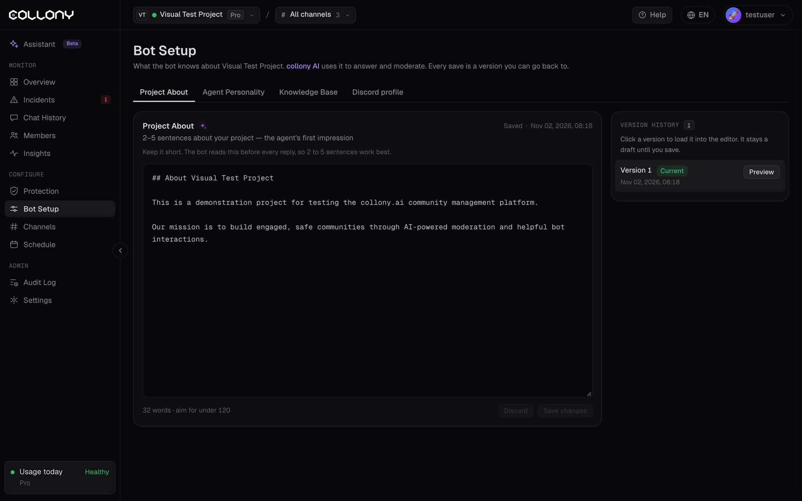

बॉट सेटअप में आप बॉट को बताते हैं कि वह क्या जानता है और कैसे बात करता है। collony AI इसका इस्तेमाल जवाब देने और मॉडरेट करने में करता है। पेज पर चार टैब हैं: **प्रोजेक्ट परिचय**, **एजेंट पर्सनैलिटी**, **नॉलेज बेस** और **Discord प्रोफ़ाइल**।

<Frame>
  
</Frame>

## सेव करना और वर्ज़न

कोई टैब एडिट करें और **बदलाव सेव करें** पर क्लिक करें, या बदलाव छोड़ने के लिए **रद्द करें** पर। हर सेव एक वर्ज़न बनता है। **वर्ज़न हिस्ट्री** खोलें और किसी वर्ज़न पर क्लिक करके उसे एडिटर में लोड करें। सेव करने तक वह ड्राफ़्ट रहता है, इसलिए आप बिना जोखिम किसी भी पुराने वर्ज़न पर लौट सकते हैं।

<Note>
  कम्युनिटी के नियम अब सुरक्षा पेज के [AI नियम](/hi/ai-rules) टैब में हैं, उन तैयार नियमों के पास जो उन्हें लागू करते हैं।
</Note>

<Tip>
  [असिस्टेंट](/hi/assistant) यह आपके लिए लिख सकता है। अपनी वेबसाइट या व्हाइटपेपर पेस्ट करें, और वह प्रोजेक्ट परिचय और नॉलेज बेस का ड्राफ़्ट बना देगा।
</Tip>

## नॉलेज बेस

नॉलेज बेस से ही बॉट के जवाब बनते हैं। यह जितना पूरा और व्यवस्थित होगा, बॉट उतने अच्छे जवाब देगा और उतना कम अंदाज़ा लगाएगा। कमज़ोर नॉलेज बेस से बॉट या तो हर बात पर "मुझे नहीं पता" कहता है या भरोसे के साथ गलत जवाब देता है।

**इसे बनाने का सबसे तेज़ तरीका:** अपनी वेबसाइट, व्हाइटपेपर, डॉक्स, FAQ, हेल्प आर्टिकल, हाल की घोषणाएं और ब्लॉग पोस्ट इकट्ठा करें। इन्हें असिस्टेंट में या अपने किसी भी AI टूल में पेस्ट करें, और कहें कि कंटेंट को विषय के हिसाब से बांटे, दोहराव हटाए और सादे टेक्स्ट में दे। नतीजा यहां पेस्ट करें।

पूरे नॉलेज बेस में ये होना चाहिए:

- प्रोजेक्ट क्या है, कैसे काम करता है और कौन सी समस्या हल करता है
- हर वह सवाल जो आपकी कम्युनिटी अक्सर पूछती है, साफ़ जवाबों के साथ
- आधिकारिक लिंक, सोशल हैंडल और कौन सी चीज़ कहां मिलेगी
- मुख्य नीतियां: क्या अनुमति है, क्या नहीं, और सपोर्ट कैसे काम करता है
- टीम के हैंडल, ताकि बॉट जाने कि दायरे से बाहर की बात पर किसे टैग करे
- स्कैम से बचाव: टीम मेंबर्स से कैसे संपर्क करेगी और कैसे कभी नहीं करेगी

<Warning>
  बॉट सिर्फ़ वही जानता है जो नॉलेज बेस में है। अगर कुछ छूटा है, तो वह जवाब नहीं देगा या अंदाज़ा लगाएगा। प्रोजेक्ट बदलने पर इसे अपडेट करें। छोटा और साफ़ नॉलेज बेस जवाबों को तेज़ और सस्ता भी बनाता है।
</Warning>

## प्रोजेक्ट परिचय

आपके प्रोजेक्ट का 2 से 5 वाक्यों का सार, बॉट की पहली छाप। बॉट हर जवाब से पहले इसे पढ़ता है, इसलिए इसे छोटा रखें। तथ्यों पर रहें, जैसे कोई ब्रीफ़िंग, सेल्स पिच नहीं।

<Note>
  **उदाहरण:** "हम एक प्लेटफ़ॉर्म हैं जो इंडी गेम डेवलपर्स को अपने गेम पब्लिश करने और बेचने में मदद करता है। हमारी कम्युनिटी में अपना काम दिखाने वाले डेवलपर, फ़ीडबैक देने वाले खिलाड़ी और सीखने वाले नए लोग हैं। टीम में तीन लोग हैं और कम्युनिटी को स्वागत भरा और विषय पर बनाए रखने के लिए वे कम्युनिटी पर भरोसा करते हैं।"
</Note>

## एजेंट पर्सनैलिटी

इससे बॉट किसी ऑटो-रिप्लाई की बजाय आपकी टीम का सदस्य लगता है। कोई पर्सनैलिटी पेस्ट करें और सेव करें। इसे बदलना आसान है, इसलिए प्रयोग करें।

बॉट प्रोजेक्ट की जानकारी और टीम के हैंडल नॉलेज बेस से लेता है, इसलिए पर्सनैलिटी सिर्फ़ लहजे और व्यवहार को तय करती है।

<Note>
  चार तैयार टेम्पलेट (Professional, Friendly, Playful, Degen) [अंग्रेज़ी पेज](/bot-setup) पर हैं। वे अंग्रेज़ी में हैं और वैसे ही काम करते हैं: बॉट हर मेंबर को उसकी अपनी भाषा में जवाब देता है।
</Note>
