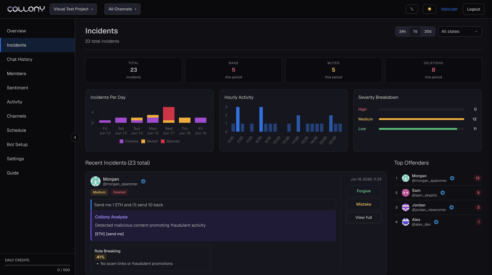

The Incidents page lists every moderation action in the current project, by the bot or by your team. Use it to check the bot's decisions, handle cases it flagged for you, and spot repeat offenders.

<Frame>
  
</Frame>

## Needs review

Cases the bot wants you to look at, for example a **Ban suggested** when the bot is not allowed to ban on its own (see [Enforcement and filters](/enforcement#allow-bot-to-ban)) or a message a blocklist flagged.

For each case, click **Open** to see it in full, or **Mark reviewed** when the bot got it right.

## Summary

For the selected range (24h, 7d or 30d):

- Incidents and actions, with the change against the previous period
- Deleted, muted and banned counts
- A chart of incidents and actions per day

### By type

Shows who or what acted: **AI**, **Instant guard**, **Moderator** and the other layers, each with its deletions, mutes and bans.

### Top offenders

The members with the most incidents in the range. Click **All offenders** or a member to see more.

## Incident list

Two tabs: **Incidents** for single cases and **Offenders** for members grouped by their incidents.

Filter the list by:

| Filter | Options |
| --- | --- |
| **Type** | AI, Instant guard, Story filter, Moderator, Blocklist, Surge Guard, Impersonation |
| **Severity** | Critical, High, Medium, Low |
| **State** | Active, Forgiven, collony.ai mistake |

Use the search box to find a member or message.

## Incident states

| State | Meaning |
| --- | --- |
| **Active** | The incident stands. The restriction is in place or the deletion was correct. |
| **Forgiven** | You cleared the incident and lifted any restriction. It no longer counts toward [repeat offender bans](/enforcement#ban-repeat-offenders). |
| **collony.ai mistake** | Marked as a false positive. The action was reverted. |

Click **Forgive** or **Mistake** on any incident to change its state. Marking mistakes helps collony.ai improve detection for your community. You can do the same from the chat with `/forgive` and `/fp`. See [Chat commands](/chat-commands).
