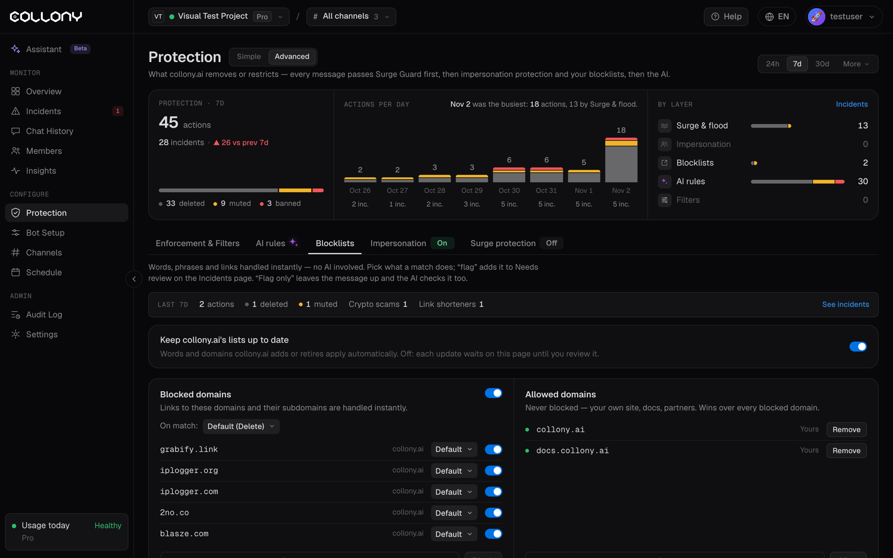

Le blocklist gestiscono parole, frasi e link all'istante, prima che l'IA legga il messaggio. Aprile dalla scheda **Blocklist** della pagina [Protezione](/it/protection), in vista Avanzata. La vista Semplice mostra le stesse liste in forma ridotta.

In alto nella scheda vedi cosa hanno intercettato le liste negli ultimi 7 giorni e quali liste sono scattate.

<Frame>
  
</Frame>

## Cosa succede con una corrispondenza

Per ogni dominio, raccolta o voce scegli l'azione:

| Azione | Risultato |
| --- | --- |
| **Predefinita** | Usa l'azione predefinita della lista |
| **Solo segnala** | Lascia il messaggio, lo aggiunge a **Da revisionare** e lascia che anche l'IA lo controlli |
| **Elimina** | Elimina il messaggio |
| **Elimina + segnala** | Elimina il messaggio e lo aggiunge a Da revisionare |
| **Elimina + silenzia** | Elimina il messaggio e silenzia il membro |
| **Elimina + silenzia + segnala** | Tutto quanto sopra |
| **Banna** | Rimuove il membro |

## Tieni aggiornate le liste di collony.ai

Se attivo, le parole e i domini che collony.ai aggiunge o ritira si applicano automaticamente al tuo progetto. Se spento, ogni aggiornamento aspetta in questa pagina che tu lo controlli.

## Domini bloccati

I link a questi domini e a tutti i loro sottodomini vengono gestiti all'istante. Scrivi un dominio e fai clic su **Blocca**. I domini aggiunti da collony.ai sono indicati come tali.

## Domini consentiti

I domini di questa lista non vengono mai bloccati: il tuo sito, la tua documentazione, i tuoi partner. Un dominio consentito prevale su qualsiasi dominio bloccato e sul [limite ai link dei nuovi membri](/it/enforcement). Scrivi un dominio e fai clic su **Consenti**.

<Tip>
  Aggiungi i tuoi link ufficiali ai Domini consentiti prima di rendere più severe le regole sui link. Così il bot non eliminerà i tuoi annunci.
</Tip>

## Raccolte

Liste che collony.ai gestisce per te. Attivane una, scegli cosa succede con una corrispondenza e aggiungi le tue voci.

| Raccolta | Cosa individua | Azione predefinita |
| --- | --- | --- |
| **Fonti di truffe note** | Utenti e canali i cui messaggi inoltrati e storie erano truffe in altre community | Elimina + silenzia |
| **Truffe crypto** | Airdrop falsi, svuota-wallet, rendimenti garantiti e truffe di recupero | Elimina + silenzia |
| **Truffe via contatto / DM** | Falso supporto, "scrivimi in privato", segnali a pagamento | Elimina |
| **Spam per adulti** | Promozione di contenuti per adulti e link di webcam o incontri | Elimina + silenzia |
| **Accorciatori di link** | Link accorciati che nascondono la destinazione, un modo comune per far passare truffe | Elimina |
| **Insulti** | Insulti razzisti, etnici, omofobi, transfobici e abilisti, anche con grafie camuffate | Elimina |

Ogni raccolta mostra le voci attive, quante sono tue, le corrispondenze degli ultimi 7 giorni e le voci più frequenti.

### Le tue aggiunte

Aggiungi la tua **parola**, **frase** o **dominio** a qualsiasi raccolta, con la sua azione, oppure fai clic su **Importa file** per aggiungerne molte insieme. Togli una voce con **Rimuovi**.

La lista **Voci di collony.ai** mostra ciò che collony.ai gestisce in quella raccolta. Esporta qualsiasi raccolta in JSON, CSV o TXT.
