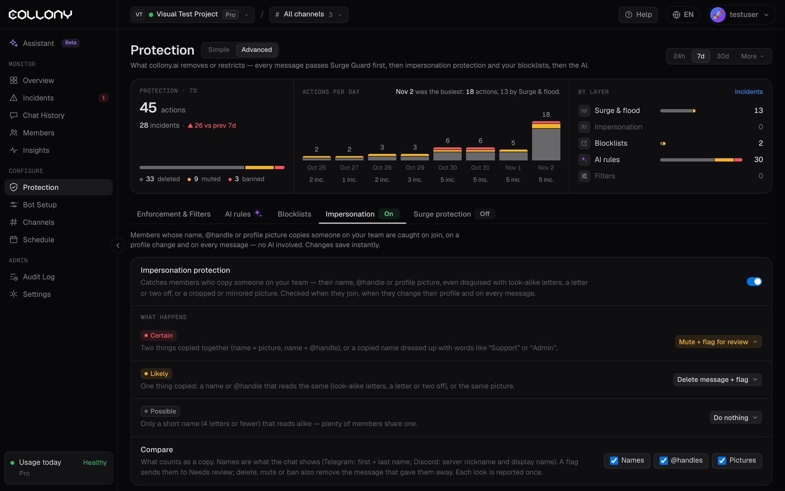

La protezione dall'impersonificazione individua i membri che copiano qualcuno del tuo team: il nome, l'@username o la foto profilo. Individua anche le copie camuffate, come lettere simili, una o due lettere diverse, o una foto ritagliata o specchiata. Non usa IA e le modifiche si salvano subito.

I membri vengono controllati quando entrano, quando cambiano profilo e a ogni messaggio. Aprila dalla scheda **Impersonificazione** della pagina [Protezione](/it/protection), in vista Avanzata.

<Frame>
  
</Frame>

## Chi è protetto

- Proprietari, amministratori, moderatori e membri del team del progetto
- Gli amministratori di ogni chat Telegram (il bot li trova da solo)
- Lo staff del server Discord: il proprietario e i membri con permessi di moderazione

Assegna a chiunque altro del tuo team il ruolo **Membro del team** in [Membri](/it/members). Non dà permessi, ma lo protegge dalle copie. Le foto vengono confrontate dopo che il bot le ha viste.

## Cosa succede

Ogni corrispondenza viene classificata in base a quanto il bot è sicuro. Scegli tu l'azione per ogni livello.

| Livello | Quando |
| --- | --- |
| **Certo** | Due elementi copiati insieme (nome e foto, o nome e @username), o un nome copiato con parole come "Support" o "Admin" |
| **Probabile** | Un solo elemento copiato: un nome o un @username che si legge uguale, o la stessa foto |
| **Possibile** | Solo un nome corto (4 lettere o meno) che si legge simile. Molti membri ne condividono uno. |

Azioni per ogni livello: **Non fare nulla**, **Segnala per revisione**, **Elimina messaggio + segnala**, **Silenzia + segnala per revisione** o **Banna**.

Segnalare manda il membro in **Da revisionare** nella pagina [Incidenti](/it/incidents). Eliminare, silenziare e bannare rimuovono anche il messaggio che lo ha tradito. Ogni copia viene segnalata una sola volta.

## Confronta

Scegli cosa conta come copia: **Nomi**, **@username** e **Foto**.

- I **nomi** sono quelli mostrati in chat: nome e cognome su Telegram, nickname del server e nome visualizzato su Discord.
- Le **foto** vengono confrontate per come appaiono, non per il file. Una copia ingrandita o specchiata conta comunque. Risalvarla, ridimensionarla, cambiarne i colori o aggiungere una cornice non la nasconde.

## Esempi

La pagina mostra come il bot giudica le copie di uno dei tuoi amministratori. Con un amministratore di nome Taylor Quinn (@taylor_quinn):

| Il membro appare come | Corrispondenza |
| --- | --- |
| Taylor Quinn, stessa foto, @tayIor_quinn | Certo |
| Taylor Quinn \| Support, foto propria | Certo |
| Talyor Quinn (una lettera diversa), foto specchiata | Certo |
| Altro nome, stessa foto ingrandita | Probabile |
| TayIor Quinn (lettere simili) | Probabile |
| Quinn Taylor (parole invertite) | Probabile |
| Taylor (solo il nome) | Nessuna corrispondenza |

<Tip>
  Se viene segnalato il tuo stesso team, controlla che tutti abbiano il ruolo giusto in [Membri](/it/members).
</Tip>
