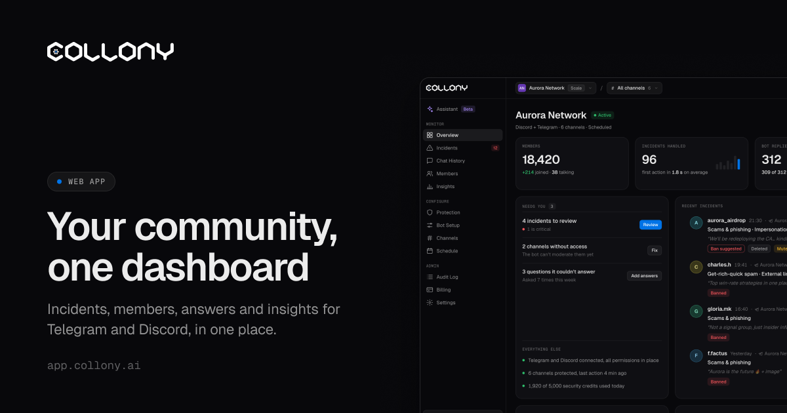
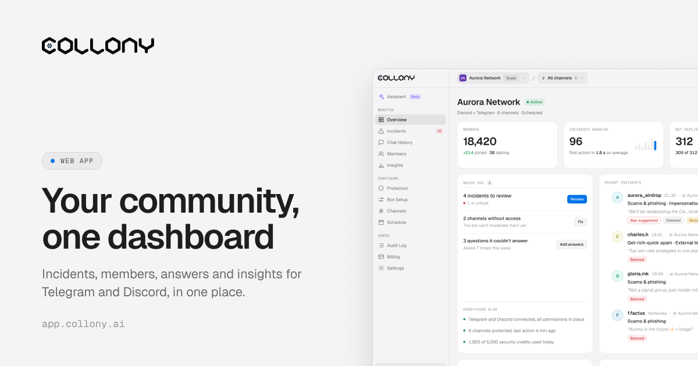

<Frame>
  
  
</Frame>

collony.ai sorveglia le tue community di Telegram e Discord giorno e notte. Rimuove spam e truffe in tempo reale, risponde alle domande dei membri con la tua knowledge base e ti mostra tendenze che il tuo team non noterebbe.

Nell'app, su [app.collony.ai](https://app.collony.ai), configuri il bot, controlli ogni azione di moderazione, segui l'umore della community e gestisci il tuo team, per tutti i tuoi progetti e su entrambe le piattaforme.

<Note>
  Ti serve aiuto o vuoi vedere collony.ai all'opera? Unisciti alla community su [Telegram](https://t.me/collony_official) o [Discord](https://discord.gg/na6xcu7xV7).
</Note>

## Per iniziare

<Columns cols={2}>
  <Card title="Accesso" href="/it/login">
    Accedi e collega i tuoi account Telegram, Discord e Google.
  </Card>
  <Card title="Progetti" href="/it/projects">
    Aggiungi il bot a un gruppo o server e crea il tuo primo progetto.
  </Card>
  <Card title="Fatturazione" href="/it/billing">
    Piani Free, Protect, Grow e Scale, crediti e prove gratuite.
  </Card>
</Columns>

## Configurazione

<Columns cols={2}>
  <Card title="Configurazione del bot" href="/it/bot-setup">
    Knowledge base, descrizione del progetto e personalità dell'agente.
  </Card>
  <Card title="Canali" href="/it/channels">
    Scegli cosa fa il bot in ogni canale.
  </Card>
  <Card title="Orari" href="/it/schedule">
    Decidi quando funziona il bot e in quale modalità.
  </Card>
  <Card title="Impostazioni" href="/it/settings">
    Stato del bot, lingua, risposte in chat e app di IA.
  </Card>
</Columns>

## Protezione

<Columns cols={2}>
  <Card title="Protezione" href="/it/protection">
    Come viene controllato ogni messaggio, livello per livello.
  </Card>
  <Card title="Regole IA" href="/it/ai-rules">
    Le regole della tua community e le regole predefinite.
  </Card>
  <Card title="Blocklist" href="/it/blocklists">
    Blocco istantaneo di parole, frasi e domini.
  </Card>
  <Card title="Impersonificazione" href="/it/impersonation">
    Individua gli account che copiano il tuo team.
  </Card>
  <Card title="Surge Guard" href="/it/surge-guard">
    Modalità lenta automatica contro ondate di messaggi e raid.
  </Card>
  <Card title="Sanzioni e filtri" href="/it/enforcement">
    Controllo dei media, durata del silenziamento e regole di ban.
  </Card>
</Columns>

## Moderazione

<Columns cols={2}>
  <Card title="Incidenti" href="/it/incidents">
    Controlla cosa ha fatto il bot e gestisci la coda da revisionare.
  </Card>
  <Card title="Cronologia chat" href="/it/chat-history">
    Sfoglia, cerca e modera i messaggi di tutti i canali.
  </Card>
  <Card title="Membri" href="/it/members">
    Gestisci i ruoli e trova i membri.
  </Card>
  <Card title="Registro attività" href="/it/audit-log">
    Ogni modifica e chi l'ha fatta.
  </Card>
  <Card title="Comandi chat" href="/it/chat-commands">
    Modera da Telegram o Discord con i comandi.
  </Card>
</Columns>

## Analisi

<Columns cols={2}>
  <Card title="Panoramica" href="/it/overview">
    Un colpo d'occhio sulla salute della community.
  </Card>
  <Card title="Insights" href="/it/insights">
    Umore, argomenti, domande senza risposta e ritmo.
  </Card>
</Columns>

## Strumenti IA

<Columns cols={2}>
  <Card title="Assistente" href="/it/assistant">
    Chiedi come funziona qualcosa o cosa cambiare.
  </Card>
  <Card title="App di IA" href="/it/ai-apps">
    Gestisci collony.ai da Claude, ChatGPT o Cursor.
  </Card>
</Columns>
