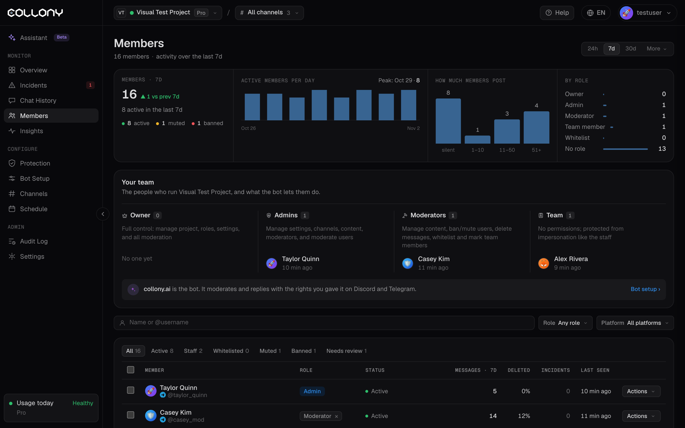

La pagina Membri elenca ogni utente che collony.ai ha visto nel progetto attuale. Usala per gestire i ruoli del tuo team, trovare membri e agire su più persone insieme.

Scegli il periodo in alto: 24h, 7g, 30g, o **Altro** per altre opzioni o un intervallo personalizzato.

<Frame>
  
</Frame>

## Riepilogo

- Membri, quanti sono stati attivi e la variazione rispetto al periodo precedente
- Totali di attivi, silenziati e bannati
- **Membri attivi al giorno**, con il giorno di punta
- **Quanto scrivono i membri**: silenziosi, da 1 a 10, da 11 a 50, e 51 messaggi o più
- **Per ruolo**: quanti membri hanno ciascun ruolo

## Il tuo team

Le persone che gestiscono il progetto, raggruppate per ruolo, e cosa il bot permette loro di fare.

| Ruolo | Cosa può fare |
| --- | --- |
| **Proprietario** | Controllo totale: gestire progetto, ruoli, impostazioni e tutta la moderazione |
| **Amministratore** | Gestire impostazioni, canali, contenuti e moderatori, e moderare gli utenti |
| **Moderatore** | Gestire i contenuti, silenziare e bannare, eliminare messaggi, aggiungere alla whitelist e indicare i membri del team |
| **Fatturazione** | Gestire piano, pagamento e progetti collegati. Nessun potere di moderazione. |
| **Membro del team** | Nessun permesso. Protetto dall'[impersonificazione](/it/impersonation) come lo staff. |
| **Whitelist** | Salta solo il rilevamento dei contenuti malevoli |

Un membro può avere più ruoli e i permessi si sommano.

<Warning>
  Assegna qui il ruolo ai tuoi veri amministratori, moderatori e agli altri membri del team. La [protezione dall'impersonificazione](/it/impersonation) usa questi ruoli per distinguere il tuo team dagli account che lo copiano.
</Warning>

## Elenco dei membri

Ogni riga mostra il membro, i suoi ruoli, lo stato (Attivo, Silenzioso, Silenziato, Bannato), i messaggi nel periodo, la quota eliminata, gli incidenti e quando è stato visto l'ultima volta.

### Filtri

- Schede: **Tutti**, **Attivi**, **Staff**, **In whitelist**, **Silenziati**, **Bannati**, **Da revisionare**
- **Ruolo**: qualsiasi ruolo, o uno solo. **Ordina: staff prima** mette il tuo team in cima.
- **Piattaforma**: tutte, Telegram o Discord
- Cerca per @username o per nome visualizzato

### Azioni

Apri il menu **Azioni** di una riga per aprire il profilo, assegnare o togliere un ruolo, silenziare, bannare o sbannare.

Per agire su più membri insieme, selezionali e usa **Aggiungi ruolo**, **Rimuovi ruolo**, **Silenzia**, **Riattiva voce**, **Banna** o **Sbanna**.

Puoi anche gestire la whitelist dalla chat con `/whitelist` e `/unwhitelist`. Vedi [Comandi chat](/it/chat-commands).

<Tip>
  Metti in whitelist i partner verificati e i contributori di lunga data che vengono segnalati spesso. Potranno scrivere liberamente e tutti gli altri resteranno protetti.
</Tip>

Fai clic su un membro per aprire il suo [profilo](/it/member-details).
