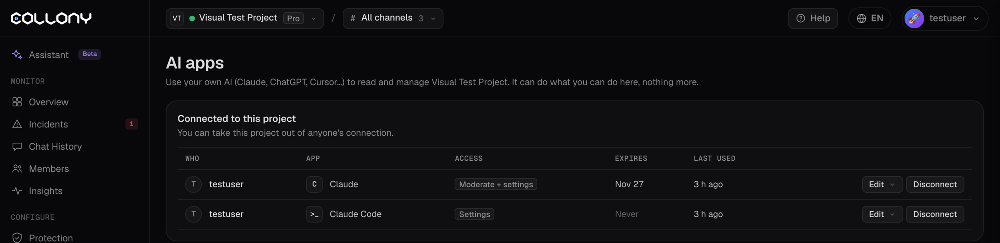

Connect your own AI to collony.ai and manage your communities in plain language. Ask "what happened in the chat this week?", "mute the account posting airdrop links" or "turn off chat replies on weekends", and your AI does it for you.

It works through the collony.ai MCP server, and it can only do what you can do in the app.

<Frame>
  
</Frame>

## Before you start

You need:

- A collony.ai account with access to at least one project
- One of these: Claude, ChatGPT, Claude Code, Cursor or VS Code
- The server URL:

```text
https://app.collony.ai/mcp
```

You can also copy it from **Settings**, then **Connect or manage AI apps**, in the app.

## Connect your AI app

Pick your app and follow the steps.

<Tabs>
  <Tab title="Claude">
    <Steps>
      <Step title="Open Connectors">
        In Claude, go to **Settings**, then **Connectors**, and click **Add custom connector**.
      </Step>
      <Step title="Add collony.ai">
        Name it **Collony** and paste the server URL: `https://app.collony.ai/mcp`. Click **Add**.
      </Step>
      <Step title="Connect">
        Click **Connect**. A collony.ai window opens. Sign in if you are asked to.
      </Step>
      <Step title="Choose projects and access">
        Pick the projects Claude may use and what it may do (see [Choose what the app may do](#choose-what-the-app-may-do)). Click **Save**. You are sent back to Claude.
      </Step>
      <Step title="Try it">
        Start a new chat and ask: "Using Collony, what happened in my community this week?"
      </Step>
    </Steps>
  </Tab>
  <Tab title="ChatGPT">
    <Steps>
      <Step title="Turn on developer mode">
        In ChatGPT, go to **Settings**, then **Apps**, and turn on **developer mode**.
      </Step>
      <Step title="Create the app">
        Click **Create app**. Name it **Collony** and paste the server URL: `https://app.collony.ai/mcp`.
      </Step>
      <Step title="Connect">
        Click **Connect**. A collony.ai window opens. Sign in if you are asked to.
      </Step>
      <Step title="Choose projects and access">
        Pick the projects ChatGPT may use and what it may do (see [Choose what the app may do](#choose-what-the-app-may-do)). Click **Save**.
      </Step>
      <Step title="Try it">
        Start a new chat, select the Collony app and ask: "What happened in my community this week?"
      </Step>
    </Steps>
  </Tab>
  <Tab title="Claude Code">
    <Steps>
      <Step title="Add the server">
        Run this in your terminal:

        ```bash
        claude mcp add --transport http collony https://app.collony.ai/mcp
        ```
      </Step>
      <Step title="Connect">
        Start Claude Code, type `/mcp`, pick **collony** and choose to authenticate. A collony.ai window opens in your browser. Sign in if you are asked to.
      </Step>
      <Step title="Choose projects and access">
        Pick the projects Claude Code may use and what it may do. Click **Save** and go back to the terminal.
      </Step>
      <Step title="Try it">
        Ask: "Using Collony, list my projects and show this week's incidents."
      </Step>
    </Steps>
  </Tab>
  <Tab title="Cursor">
    <Steps>
      <Step title="Add the server">
        Open **Cursor Settings**, then **MCP**, and add a new server. Or add this to your `mcp.json`:

        ```json
        {
          "mcpServers": {
            "collony": {
              "url": "https://app.collony.ai/mcp"
            }
          }
        }
        ```
      </Step>
      <Step title="Connect">
        Cursor shows collony as needing login. Click it. A collony.ai window opens in your browser. Sign in if you are asked to.
      </Step>
      <Step title="Choose projects and access">
        Pick the projects Cursor may use and what it may do. Click **Save**.
      </Step>
      <Step title="Try it">
        In the chat, ask: "Using Collony, list my projects and show this week's incidents."
      </Step>
    </Steps>
  </Tab>
  <Tab title="VS Code">
    <Steps>
      <Step title="Add the server">
        Add this to `.vscode/mcp.json` in your workspace, or to your user MCP settings:

        ```json
        {
          "servers": {
            "collony": {
              "type": "http",
              "url": "https://app.collony.ai/mcp"
            }
          }
        }
        ```
      </Step>
      <Step title="Connect">
        Click **Start** above the server in `mcp.json`. A collony.ai window opens in your browser. Sign in if you are asked to.
      </Step>
      <Step title="Choose projects and access">
        Pick the projects VS Code may use and what it may do. Click **Save**.
      </Step>
      <Step title="Try it">
        In Copilot Chat, in agent mode, ask: "Using Collony, list my projects and show this week's incidents."
      </Step>
    </Steps>
  </Tab>
</Tabs>

<Tip>
  Any other app that supports remote MCP servers works too. Add `https://app.collony.ai/mcp` as an HTTP server and connect.
</Tip>

## Choose what the app may do

When you connect, you choose the access for that app. Start small. You can change it any time.

| Access | What the app can do |
| --- | --- |
| **Read** | See settings, bot texts, members, chat history and stats |
| **Read + moderate** | Also mute and ban members, use Surge Guard and post messages as the bot |
| **Read + change settings** | Also change the schedule, features, protection, channels and bot texts |
| **Moderate + change settings** | Everything above |

You also set:

- **Limit mutes and bans**: the most mutes and bans the app can make per hour, for example 20. It stops a confused or tricked AI from sweeping your chat.
- **Expires**: 30 days, 90 days, 1 year or never. You get a warning 7 days before access ends.

## Things to ask

<AccordionGroup>
  <Accordion title="Check on your community">
    - "What happened in my community this week?"
    - "Show me today's incidents and what the bot did."
    - "Which questions went unanswered in the last 7 days?"
    - "Who are the most active members this month?"
  </Accordion>

  <Accordion title="Moderate">
    - "Find the member posting airdrop links and mute them for 24 hours."
    - "Show the messages from @username in the last day."
  </Accordion>

  <Accordion title="Change settings">
    - "Turn off chat replies on Saturday and Sunday."
    - "Turn on Surge Guard for the main chat."
    - "Block the domain example-scam.xyz."
  </Accordion>

  <Accordion title="Update what the bot knows">
    - "Our launch moved to March 14. Update the knowledge base."
    - "Add a FAQ answer: the team never DMs first."
  </Accordion>

  <Accordion title="Post as the bot">
    - "Post a reminder in the main chat that admins never DM first."
    - "Schedule an AMA announcement for Friday at 14:00 UTC."
  </Accordion>
</AccordionGroup>

<Tip>
  Ask the app to check before it changes anything, for example "show me the current schedule, then turn off weekends".
</Tip>

## See and undo what it did

Open **Settings**, then **Connect or manage AI apps**. Under **Recent calls** you see every call an app made in the project: who, which app, what it did, and whether it was applied.

- Click **Undo** on any change to revert it.
- Every change is also in the [Audit Log](/audit-log), marked with the app's name.
- Messages an app posts as the bot show in [Chat History](/chat-history) as sent via that app.

Member messages are treated as untrusted. The app never mutes, bans or posts because a member's message tells it to.

## Manage or disconnect

The AI apps page lists every app connected to the project, with who connected it, its access, when it expires and when it was last used.

- **Edit** changes its projects, access, limits or expiry.
- **Disconnect** removes it.

You can also see all your connected apps on your **Account** page.
