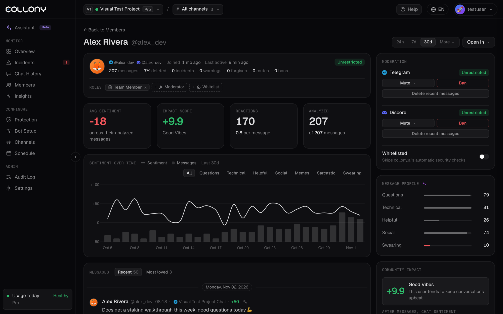

Member Details is the full profile of one community member. Open it by clicking a member anywhere in the app. Click **Back to Members** to return. Pick the range at the top: 24h, 7d, 30d or **More**.

<Frame>
  
</Frame>

## Identity and record

The member's name and handles, when they joined and when they were last active. **Open in** takes you to them on Telegram or Discord.

The record shows messages sent, the share deleted, incidents, warnings, forgiven incidents, mutes, bans and their current status, for example **Unrestricted**.

## Roles

Current roles show as badges. Add roles with **\+ Moderator**, **\+ Team member** and **\+ Whitelist**, or remove one with its **×**. See [Members](/members#your-team) for what each role does.

## Moderation actions

| Action | Options |
| --- | --- |
| **Mute** | 24 hours (default), 1 hour or 7 days |
| **Ban** | Permanent on Discord. Telegram bans can have a duration from the chat. |
| **Delete recent messages** | Removes the member's latest messages |
| **Whitelist user** | Marks the member as trusted. They skip automatic security checks in this project until you revoke it. |

<Warning>
  Actions from the app take effect in the community right away.
</Warning>

## Sentiment and engagement

- **Avg sentiment**: average mood across their analyzed messages
- **Impact score**: how much the member lifts or drags the community, with a label such as Good Vibes
- **Reactions**: reactions received, with the average per message
- **Analyzed**: messages scored out of all messages sent

**Sentiment over time** charts mood and messages for the last 30 days. Filter it by message type: Questions, Technical, Helpful, Social, Memes, Sarcastic or Swearing.

## Messages

Two tabs: **Recent** with their latest messages, and **Most loved** with their most reacted-to posts. Each message shows the channel, mood score, reactions and what happened to it. Open the menu on a message to open it, copy it, mute, ban or delete. Click a message to open its [details](/message).
