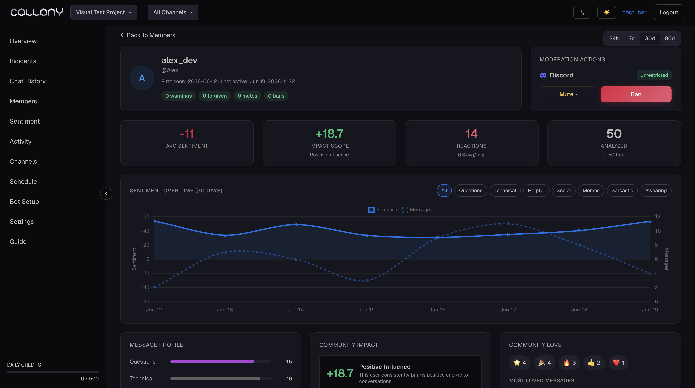

Member Details is the full profile of one community member. Open it by clicking a member on the Members page, or any name in Incidents, Chat History or Insights. Click **Back to Members** to return.

<Frame>
  
</Frame>

## Identity

The member's name and handles on each platform, whether they have a collony.ai web account, when they joined and when they were last active. **Open in Telegram** and **Open in Discord** take you to them on the platform.

The record below shows messages sent, the share deleted, incidents, warnings, forgiven incidents, mutes and bans.

## Roles

Current roles show as badges. Add roles with **\+ Admin**, **\+ Moderator**, **\+ Team member** and **\+ Whitelist**, or remove one with its **×**.

## Moderation actions

Actions are shown separately for each platform the member uses, with their current status there, for example **Unrestricted**.

| Action | Options |
| --- | --- |
| **Mute** | 24 hours (default), 1 hour or 7 days |
| **Ban** | Permanent on Discord. Telegram bans can have a duration from the chat. |
| **Delete recent messages** | Removes the member's latest messages on that platform |
| **Whitelist user** | Marks the member as trusted. They skip automatic security checks in this project until you revoke it. |

<Warning>
  Actions from the app take effect in the community right away.
</Warning>

## Sentiment and engagement

- **Avg Sentiment**: average positivity across their scored messages
- **Impact Score**: how much the member shapes the community
- **Reactions**: reactions received, with the average per message
- **Analyzed**: messages scored out of all messages sent

**Sentiment over time** charts the last 30 days. Filter it by message type: Questions, Technical, Helpful, Social, Memes, Sarcastic or Swearing.

**Message profile** breaks their messages down by topic. **Community love** shows the reactions they received, and **Most loved messages** lists their most reacted-to posts.

## Top connections

The members this person reacted to and replied to most. Click **See User Network** for the full graph, useful for spotting coordinated accounts.

## Recent messages

Their latest messages by day, with the channel, labels, reactions and **Delete**, **Mute** and **Ban** on each one. Click a message to open its [details](/message).
