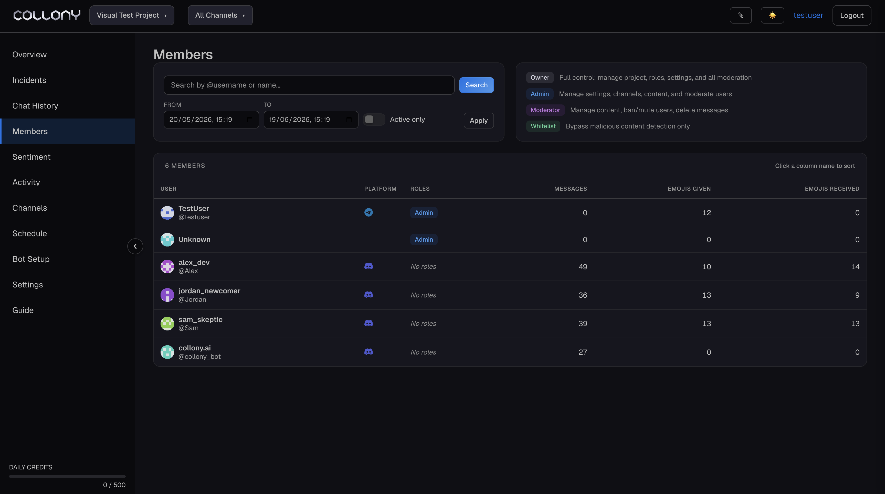

The Members page lists every user collony.ai has seen in the current project, with their roles, message counts and reactions. Use it to assign roles, find a member and open their profile.

<Frame>
  
</Frame>

## Roles

| Role | What it means |
| --- | --- |
| **Owner** | Full control of the project, its settings, roles and moderation |
| **Admin** | Manages settings, channels, content and moderation |
| **Moderator** | Deletes messages, mutes and bans members |
| **Team member** | Part of your team, with no moderation permissions. Never slowed down by [Surge Guard](/surge-guard). |
| **Whitelist** | Skips malicious content detection. No moderation permissions. |

A member can hold several roles, and the permissions add up.

<Warning>
  Give your real admins and moderators their roles here. The impersonation checks use these roles to tell your team from accounts copying them. Without them, your own team can get flagged.
</Warning>

## Assigning roles

Click **\+ Role** next to a member and pick the role. To assign a role to several members at once, select them and add the role in one step. Remove a role from the member's [profile](/member-details).

You can also manage the whitelist from the chat with `/whitelist` and `/unwhitelist`. See [Chat commands](/chat-commands).

<Tip>
  Whitelist verified partners and long-standing contributors who keep getting caught by checks. They can post freely while everyone else stays fully protected.
</Tip>

## Searching and sorting

Search by @username or display name. **Active only** narrows the list to members who sent at least one message in the selected range. Click a column header to sort by it.

Click a row to open the member's [profile](/member-details).
