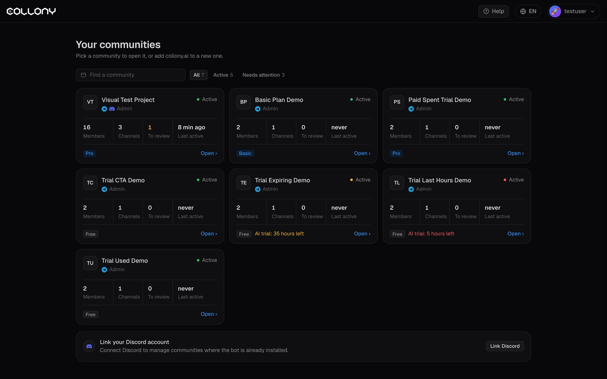

**Проект** это сообщество, которое должен защищать collony.ai. Он может включать каналы из Telegram и Discord и имеет собственные настройки, правила, аналитику и план.

<Frame>
  
</Frame>

## Ваши сообщества

На странице Проекты сообщества показаны карточками. На каждой карточке видны ваша роль, статус, участники, каналы, кейсы на проверке, время последней активности и план. Нажмите **Открыть**, чтобы перейти к проекту.

Фильтруйте по **Все**, **Активные** или **Требуют внимания**. Проект требует внимания, когда есть кейсы на проверку или что-то нужно исправить, например скоро заканчивается пробный период.

Если вы управляете серверами Discord, где бот уже установлен, нажмите **Link Discord**, чтобы увидеть их здесь.

## Добавьте бота в Telegram

1. Нажмите **\+ Добавить бота**, затем **Добавить в Telegram**.
2. Telegram откроет выбор чата. Выберите группу и подтвердите права администратора: **удаление сообщений, ограничение участников, закрепление сообщений**.
3. Завершите настройку на странице Проекты.

<Warning>
  collony.ai нужны права на удаление сообщений, ограничение участников и закрепление сообщений. Без них действия модерации не сработают.
</Warning>

## Добавьте бота в Discord

1. Нажмите **\+ Добавить бота**, затем **Добавить в Discord**.
2. Авторизуйте бота на сервере и подтвердите разрешения.
3. Завершите настройку на странице Проекты.

Затем выберите, что бот делает в каждом канале, на странице [Каналы](/ru/channels).

## Планы

Чтобы начать 7-дневный пробный период Protect или Grow либо сменить план, откройте [Оплату](/ru/billing). На карточке проекта с пробным периодом видно, сколько времени осталось.

## Деактивированные проекты

Проекты, которые вы деактивируете в [Параметрах](/ru/settings), приостанавливаются: бот выключен, оплата отменена, а проект скрыт от участников. Активируйте его снова, чтобы вернуть со всеми настройками и историей.

## Отзыв

Нажмите **Отзыв** в приложении, чтобы отправить команде идею, проблему или вопрос. Также можно пообщаться с командой в [Telegram](https://t.me/collony_official).
