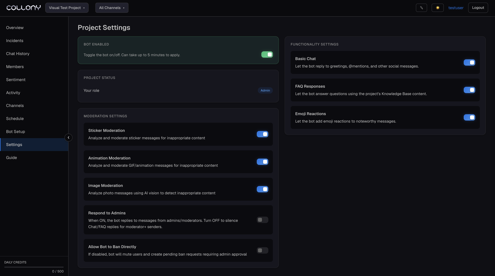

Project Settings holds the switches for the current project. Moderation settings such as image checks and ban permissions are on the [Protection](/enforcement) page.

<Frame>
  
</Frame>

## Bot status

Turns the bot on or off for this project. Changes can take up to 5 minutes to apply.

## Project name

The name shown in the project switcher and on the Projects page. Click **Save** after you change it.

## Bot language

The language for bot menus, chat notices and admin alerts: English, Spanish, French, Hindi, Ukrainian, Chinese (Traditional), Chinese (Simplified) or Russian.

The bot answers members in their own language and falls back to this one.

## Project status

Shows your role in the project and your access level. Roles are managed on the [Members](/members) page.

## Assistant

These switches control how the bot talks in your community.

| Setting | What it does |
| --- | --- |
| **Basic Chat** | Lets the bot reply to greetings, @mentions and other social messages |
| **FAQ Responses** | Lets the bot answer questions from your [Knowledge Base](/bot-setup#knowledge-base) |
| **Emoji Reactions** | Lets the bot react to noteworthy messages |
| **Respond to Admins** | When on, the bot also replies to admins and moderators. Turn it off to silence chat and FAQ replies for your team. Moderation still runs. |

Turn off **Basic Chat** and **FAQ Responses** to run the bot in silent mode: it moderates but never joins the conversation.

Chat replies are part of the Grow and Scale plans. See [Billing](/billing).

## Danger zone

**Deactivate project** does more than turn the bot off. It suspends the whole project:

- The bot stops.
- The project moves to your **Deactivated projects** list.
- Any paid subscription is canceled at the end of the current billing period.
- Promo credits run until their end date.

Type the project name to confirm. You can reactivate it later from the [Projects](/projects) page.
