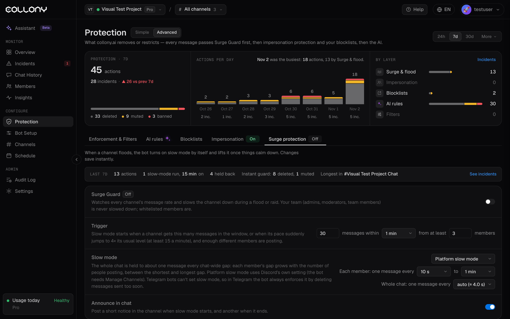

Surge Guard watches the message rate in every channel. When a channel floods, the bot turns on slow mode by itself and lifts it once things calm down. Open it from the **Surge protection** tab on the [Protection](/protection) page, in the Advanced view, or from the **Surge Guard** row in the Simple view. Switch it **On** or **Off** at the top. Changes save instantly.

With Surge Guard off, the **Instant guard** still stops single members who flood the chat.

The top of the tab shows the last 7 days: actions, slow-mode runs and how long they lasted, messages held back, what the Instant guard deleted or muted, and the channel with the longest run.

Your team (admins, moderators and team members) is never slowed down. Whitelisted members are.

<Frame>
  
</Frame>

## Trigger

Slow mode starts when both of these are true:

- A channel gets the set number of messages within the window (for example 30 messages within 1 minute), **or** its pace suddenly jumps to 4x its usual level, at least 15 messages a minute.
- Enough different members are posting. You set the minimum, for example 3 members.

The member minimum keeps one fast typer from triggering slow mode. A single flooder is handled by the Instant guard instead.

## Slow mode

While slow mode is on, the whole chat is held to about one message every few seconds. Each member's gap grows with the number of people posting, between the shortest and longest gap you set (from 10 seconds to 1 hour). The chat-wide gap can be set by hand or left on auto.

| Platform | How slow mode is applied |
| --- | --- |
| **Discord** | **Platform slow mode** uses Discord's own setting. The bot needs the Manage Channels permission. Or choose **Enforced by the bot**. |
| **Telegram** | Telegram bots cannot set slow mode, so the bot always enforces it by deleting messages sent too soon. |

## Announce in chat

With **Announce in chat** on, the bot posts a short notice in the channel when slow mode starts and another when it ends.

## Examples

With a trigger of 30 messages within 1 minute and at least 3 members:

| Situation | Result |
| --- | --- |
| 1 member posting every 3 s | Stays off. Only 1 member, so the Instant guard handles it. |
| 2 members, every 20 s each | Stays off. Only 2 members. |
| 5 members, every 15 s each | Can turn on as a spike, if the chat usually runs below 5 messages a minute. |
| 10 members, every 10 s each | Turns on. 60 messages in the window. |
| Raid: 30 members, every 5 s each | Turns on. 360 messages in the window. |

The page shows the same table for your own settings, so you can check them before a launch or AMA.

## Activity chart

The **Activity timeline** at the bottom shows message volume over 1h, 6h, 24h or 7d, live. Shaded bands mark when slow mode was on. Drag across the chart to zoom in, and click **Reset zoom** to go back.
