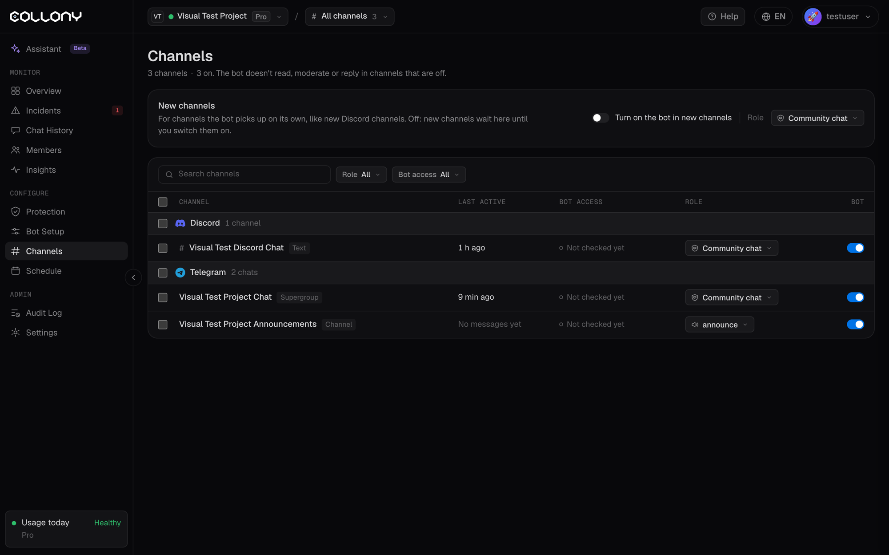

На сторінці Канали показано всі канали, які бот бачить у поточному проєкті, згруповані за платформою. Для кожного ви обираєте, чи увімкнено бота і яку роль має канал.

У вимкнених каналах бот не читає, не модерує і не відповідає. Він залишається в групі чи на сервері, але нічого там не робить.

<Frame>
  
</Frame>

## Ролі каналів

| Роль | Захищає | Відповідає |
| --- | --- | --- |
| **Чат спільноти** (за замовчуванням): тут спілкуються учасники. Бот захищає чат і відповідає на запитання. | Так | Так |
| **Лише безпека**: бот видаляє спам і шахрайство, мутить і банить, але ніколи не відповідає. | Так | Ні |
| **Лише чат і підтримка**: бот відповідає на запитання і спілкується. Тут він не модерує. | Ні | Так |
| **Сповіщення модераторам**: приватний канал для ваших модераторів. Бот публікує звіти про те, що видалив, замутив чи забанив. | Ні | Публікує звіти |

Натисніть роль поруч із каналом, щоб змінити її. У каналах, де бот відповідає, відповіді також залежать від [Розкладу](/uk/schedule) і перемикачів чату в [Параметрах](/uk/settings).

<Tip>
  Поставте каналам оголошень і офтопу роль **Лише безпека**, щоб бот тримав їх у чистоті, не втручаючись у розмову. Створіть приватний канал для команди й поставте йому роль **Сповіщення модераторам**, щоб стежити за діями бота в реальному часі.
</Tip>

## Увімкнення і вимкнення каналів

Вмикайте чи вимикайте канал у його рядку. Щоб змінити кілька каналів одразу, виберіть їх і скористайтеся **Задати роль…**, **Увімкнути** або **Вимкнути**.

## Нові канали

Налаштування **Нові канали** стосуються каналів, які бот знайде пізніше, наприклад нового каналу Discord:

- **Вмикати бота в нових каналах**: якщо вимкнено, нові канали чекатимуть на цій сторінці, доки ви їх не ввімкнете.
- **Роль для нових каналів**: роль, яку отримують нові канали, за замовчуванням Чат спільноти.

## Фільтри

Фільтруйте список за **Роллю** та **Доступом бота** (Повний доступ, Обмежений, Немає доступу, Ще не перевірено). У кожному рядку також видно тип каналу і час останньої активності.

<Warning>
  Каналу з доступом **Обмежений** або **Немає доступу** бракує дозволів, потрібних боту. Модерація там може не спрацьовувати, доки ви не виправите дозволи бота на платформі.
</Warning>
