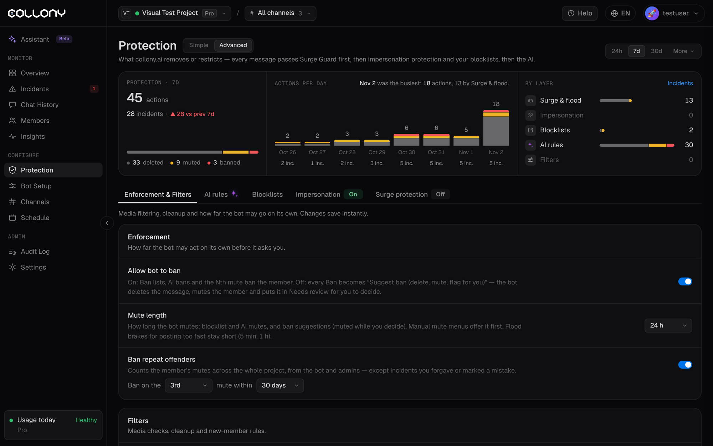

Вкладка **Санкції та фільтри** на сторінці [Захист](/uk/protection) у розширеному вигляді визначає, наскільки самостійно діє бот і які медіа він перевіряє. Зміни зберігаються одразу.

Основні налаштування санкцій є і в простому вигляді сторінки Захист, а рівень **Наскільки суворо** задає їх за вас.

<Frame>
  
</Frame>

## Санкції

### Дозволити боту банити

- **Увімкнено**: бани за блоклистами, бани ШІ та бани за повторні порушення одразу видаляють учасника. Будь-який бан можна скасувати в [Інцидентах](/uk/incidents).
- **Вимкнено**: кожен бан стає **Пропозицією бану**. Бот видаляє повідомлення, мутить учасника і додає випадок у **Потребує перевірки**, щоб ви вирішили.

<Tip>
  Почніть із вимкненим. Після кількох тижнів перегляду пропозицій увімкніть, коли довірятимете тому, як бот працює з вашою спільнотою.
</Tip>

### Тривалість муту

На скільки бот мутить учасників за блоклистами, за рішенням ШІ та під час пропозицій бану (учасник залишається в муті, поки ви вирішуєте). Від 5 хвилин до 28 днів або власна тривалість. Меню ручного муту пропонує цю тривалість першою.

Обмеження за занадто швидкі повідомлення залишаються короткими (5 хвилин або 1 година), незалежно від цього налаштування.

### Банити повторних порушників

Банить учасника на N-й мут у заданий період, наприклад на 3-й мут за 30 днів. Від 2-го до 10-го муту і період від 7 до 365 днів.

Рахуються мути від бота і від ваших адмінів у всьому проєкті. Інциденти, які ви пробачили або позначили як помилку collony.ai, не враховуються.

## Фільтри

### Фільтрація медіа

| Налаштування | Що робить | За замовчуванням |
| --- | --- | --- |
| **Image Moderation** | Перевіряє фото за допомогою ШІ-зору на неприйнятний вміст | Увімк. |
| **Animation Moderation** | Перевіряє GIF, анімації та відео за допомогою ШІ-зору | Вимк. |
| **Sticker Moderation** | Перевіряє стікери за допомогою ШІ-зору | Вимк. |

### Очищення

| Налаштування | Що робить | За замовчуванням |
| --- | --- | --- |
| **Delete Stories** | Видаляє сторіз Telegram, поширені в чаті, частий канал шахрайства | Вимк. |
| **Delete Join Messages** | Видаляє службові повідомлення Telegram «користувач приєднався» через хвилину після появи | Вимк. |

### Нові учасники

**Посилання від нових учасників** видаляє повідомлення з посиланнями від учасників, які приєдналися нещодавно. Оберіть Вимк., 1 годину, 24 години, 7 днів або власне значення. Посилання на ваші [дозволені домени](/uk/blocklists) завжди дозволені.

<Tip>
  Більшість шахрайських акаунтів постять посилання через кілька хвилин після входу. Період у 24 години зупиняє їх, не заважаючи звичайним учасникам.
</Tip>
