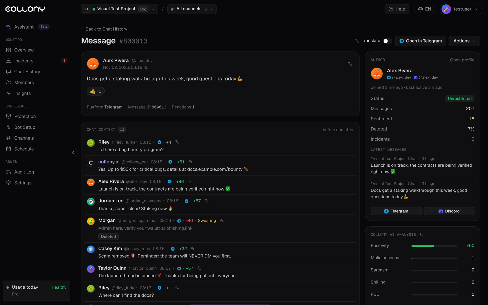

Натисніть **Відкрити повідомлення** біля будь-якого повідомлення в [Історії чату](/uk/chat-history), [Інцидентах](/uk/incidents), Огляді або профілі учасника, щоб відкрити його сторінку. Натисніть **Назад до Історії чату**, щоб повернутися.

<Frame>
  
</Frame>

## Повідомлення

Відправник, час і саме повідомлення, зокрема на що воно відповідало. Якщо хтось із вашої команди опублікував його від імені бота, видно хто і як, наприклад **Надіслано через асистента**.

- **Перекласти** показує повідомлення вашою мовою.
- **Відкрити в Telegram** (або Discord) веде до повідомлення на платформі.

Нижче: платформа, ID повідомлення, реакції, а для повідомлень бота також хто їх надіслав і коли запланував.

## Дії

Меню **Дії** видаляє повідомлення, мутить відправника на 24 години (за замовчуванням), 1 годину чи 7 днів, банить його або відкриває його профіль.

Якщо повідомлення призвело до випадку модерації, інцидент також показано тут. Натисніть **Відкрити інцидент**, щоб побачити весь випадок.

## Автор

Дата приєднання, остання активність, статус, кількість повідомлень, настрій, частка видалених повідомлень, інциденти та останні повідомлення відправника. Натисніть **Відкрити профіль**, щоб побачити [повний профіль](/uk/member-details).

## Аналіз collony AI

Оцінки, які collony.ai дав повідомленню:

| Оцінка | Значення |
| --- | --- |
| **Позитивність** | Наскільки повідомлення позитивне чи негативне |
| **Зловмисність** | Наскільки ймовірно, що це шахрайство чи атака |
| **Сарказм**, **Шилінг**, **FUD**, **Внутрішній жарт** | Сигнали, які зафіксував ШІ |

Мітки на кшталт Запитання, Пояснення, Технічне, Соціальне, Має мем і Містить лайку показують тему повідомлення.

## Контекст чату

Повідомлення до і після цього, зокрема відповіді бота, кожне з оцінкою настрою. Натисніть **Повна історія чату**, щоб побачити більше. Оцінюйте повідомлення в контексті, перш ніж діяти.
