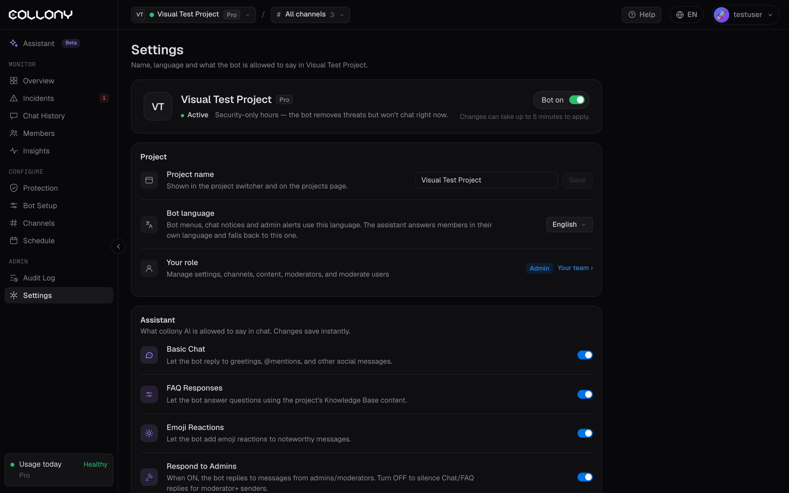

设置页面包含当前项目的名称、语言以及机器人可以说什么。管理相关设置在 [防护](/zh-Hans/protection) 页面。

<Frame>
  
</Frame>

## 状态

显示项目的方案以及机器人当前在做什么，例如“仅安全时段”，并提供 **机器人开启** 开关。更改最多需要 5 分钟生效。

## 项目

- **项目名称**：显示在项目切换器和项目页面中。修改后点击 **保存**。
- **机器人语言**：机器人菜单、聊天通知和管理员提醒使用的语言。可选英语、西班牙语、法语、意大利语、印地语、乌克兰语、中文（繁体）、中文（简体）或俄语。机器人会用成员自己的语言回答，无法识别时使用此语言。
- **你的角色**：你在项目中的角色以及它允许你做什么。点击 **你的团队** 在 [成员](/zh-Hans/members) 页面管理角色。

## 助手

collony AI 在聊天中可以说什么。更改会立即保存。

| 设置 | 作用 |
| --- | --- |
| **Basic Chat** | 允许机器人回复问候、@提及和其他社交消息 |
| **FAQ Responses** | 允许机器人根据你的 [知识库](/zh-Hans/bot-setup) 回答问题 |
| **Emoji Reactions** | 允许机器人对值得关注的消息做出表情回应 |
| **Respond to Admins** | 开启时，机器人也会回复管理员和版主。关闭后，团队成员不会收到聊天和 FAQ 回复。管理功能照常运行。 |

关闭 **Basic Chat** 和 **FAQ Responses** 可让机器人以静默模式运行：它会管理，但从不参与对话。

## AI 应用

在 Claude、ChatGPT、Cursor 或任何 MCP 应用中管理项目：询问社区情况、修改设置、执行管理，以及以机器人身份发送或定时发送消息。点击 **连接或管理 AI 应用** 进行设置。参见 [AI 应用](/zh-Hans/ai-apps)。

## 停用项目

停用项目会将其暂停：机器人停止运行，项目移到已停用项目中，付费订阅会在当前计费周期结束时取消。之后可以在 [项目](/zh-Hans/projects) 页面重新启用。
