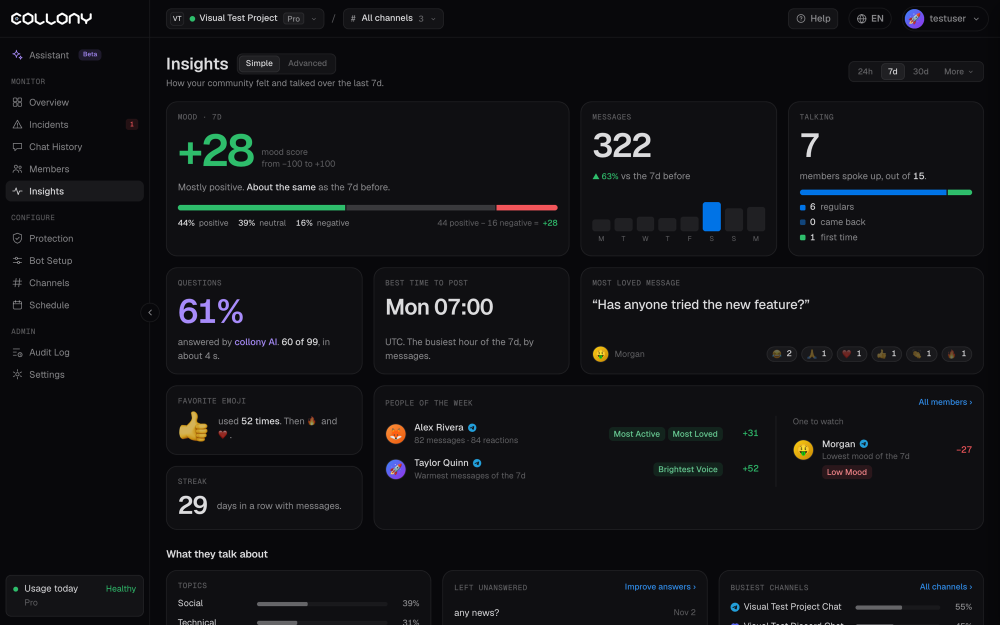

洞察展示你的社群在所選時間內的感受和交流方式。它有兩種檢視：**簡單** 和 **進階**，可在頁面頂部切換。

在頂部選擇時間範圍：24h、7d、30d，或點擊 **更多** 選擇其他預設和自訂日期。

<Frame>
  
</Frame>

## 簡單檢視

在一個頁面上以卡片形式呈現社群全貌：

| 卡片 | 顯示內容 |
| --- | --- |
| **情緒** | -100 到 +100 的分數、一句簡述（例如「以正面為主」）、與上一週期相比的變化，以及正面、中性和負面的分布 |
| **訊息** | 成員訊息數、與上一週期相比的變化和每日長條圖 |
| **發言者** | 聊天中有多少成員發言，分為常客、回歸者和新人 |
| **提問** | collony AI 回答了多少問題，以及回答速度 |
| **最佳發文時間** | 該時間內最忙碌的小時（UTC） |
| **最受歡迎的訊息** | 收到回應最多的訊息，以及誰做了回應 |
| **最愛表情** | 最常用的表情及其後幾名 |
| **連續天數** | 連續有訊息的天數 |
| **本週人物** | 最活躍的成員、最積極的聲音，以及值得留意的人（情緒最低） |

### 大家在聊什麼

- **話題**：依話題劃分的訊息佔比，例如社交、技術、提問、髒話和諷刺，以及變化最大的話題
- **未回答**：最近沒有人回答的問題。點擊 **改善回答** 將它們加入知識庫。
- **最活躍頻道**：依頻道劃分的訊息佔比

<Tip>
  **未回答** 中反覆出現的問題是最快的改善點。把答案加入 [知識庫](/zh-Hant/bot-setup)，下次機器人就能自己回答。
</Tip>

### 成長

新加入的成員以及成員分布情況，依 Telegram 和 Discord 劃分，並顯示各平台的訊息佔比。

## 進階檢視

進階檢視頂部顯示每日情緒、成員訊息、表情回應、機器人回覆、被刪訊息，以及有多少成員發言或僅做了回應。下方有六個分頁。

<Tabs>
  <Tab title="總覽">
    社群的活躍程度。

    - **活動時間軸**：即時顯示訊息隨時間的變化，可縮放 1h 至 30d。在圖表上拖曳可放大。陰影帶表示 [Surge Guard](/zh-Hant/surge-guard) 慢速模式開啟的時段。
    - **每日活躍成員**：每天發訊息的和僅做回應的成員
    - **提問與助理**：由 collony AI 回答、由成員回答或無人回答的問題佔比、平均回答時間和每日回答時間
  </Tab>
  <Tab title="成員">
    誰發言最多、誰的訊息收到回應、誰在回應。

    - **參與度**：從聊天成員到回應者、發言者、收到回應者以及受歡迎者（5 個以上回應）的漏斗，並與上一週期對比
    - **成員地圖**：每位成員依訊息數和情緒分布，大小反映收到的回應
    - **最活躍**、**收到回應最多** 和 **回應最多** 排行

    點擊成員即可開啟其 [個人資料](/zh-Hant/member-details)。
  </Tab>
  <Tab title="回應">
    社群最喜歡的訊息、誰在何時做了回應，以及成員最愛的表情。
  </Tab>
  <Tab title="情緒">
    聊天的情緒，逐則訊息評分。

    - 正面、中性和負面佔比及訊息數，以及淨情緒
    - **情緒趨勢**，包括淨情緒範圍和最忙碌的一天
    - **最積極的成員** 和 **最消極的成員**，附帶訊息數和平均分

    <Tip>
      同一帳號持續消極往往是麻煩的前兆。在變成事件之前先看看這些成員。
    </Tip>
  </Tab>
  <Tab title="節奏">
    社群何時活躍（UTC）：最近幾週的日曆、最忙碌的一天和星期幾、最長連續天數、依星期和小時劃分的活動，以及日期和小時的熱度圖。

    用它安排公告和 AMA 的時間，並設定你的 [排程](/zh-Hant/schedule)。
  </Tab>
  <Tab title="訊息">
    數字背後的已評分訊息，讓你可以讀到成員實際說了什麼。
  </Tab>
</Tabs>
