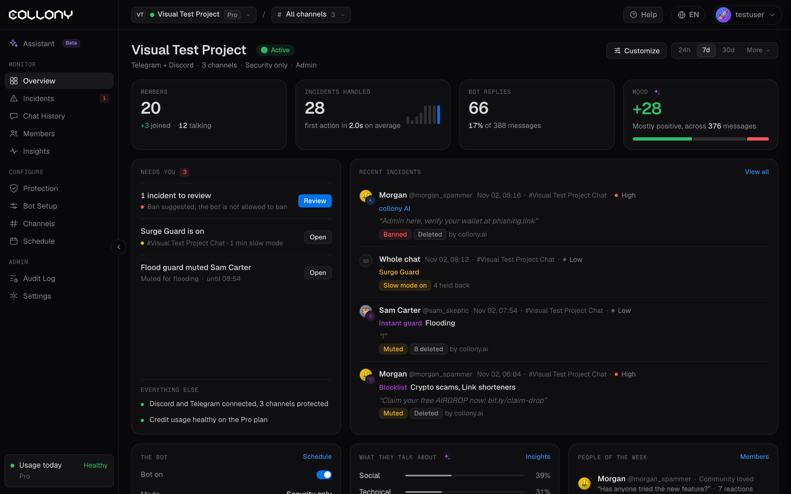

總覽是開啟專案時看到的第一個頁面，一眼就能看到專案的健康狀況以及需要你注意的事項。

<Frame>
  
</Frame>

頁首顯示專案名稱和狀態、平台、頻道數、機器人目前模式以及你的角色。在右上角選擇時間範圍：24h、7d、30d，或點擊 **更多** 選擇其他預設和自訂日期。點擊 **自訂** 選擇要顯示的區塊。

## 關鍵指標

| 卡片 | 顯示內容 |
| --- | --- |
| **成員** | 社群成員數，新加入和正在聊天的人數 |
| **已處理事件** | 管理案例以及機器人首次處理的平均速度 |
| **機器人回覆** | 機器人傳送的回覆，及其佔所有訊息的比例 |
| **情緒** | -100 到 +100 的淨情緒，以及正面、中性和負面的分布 |

## 待你處理

等待你處理的事項，例如待審查的事件、機器人建議的封鎖、Surge Guard 開啟或 Instant guard 禁言了洗版者。每項都有 **審查** 或 **開啟** 按鈕。

**其他** 顯示正常運作的內容，例如已連接的平台、受保護的頻道和額度用量。

## 最近事件

最新的管理案例，包括成員、頻道、嚴重程度、攔截來源（collony AI、Surge Guard、Instant guard、封鎖清單）以及處理結果。開啟事件選單可以開啟事件、訊息或成員，禁言、封鎖、刪除，標記為已審查、原諒或標記為誤判。點擊 **查看全部** 進入 [事件](/zh-Hant/incidents)。

## 機器人

機器人是否開啟、目前模式（例如僅安全）、活躍時段以及下一次模式切換。點擊 **排程** 進行修改。

**快速設定** 包含你最常切換的開關：基礎聊天、FAQ 回答、表情回應和 **允許機器人自行封鎖**。

## 大家在聊什麼

依話題劃分的訊息佔比，例如社交、技術、提問、髒話和諷刺，以及變化最大的話題。點擊 **洞察** 了解更多。

## 本週人物

最受歡迎的訊息、最活躍的成員、最積極和最消極的成員。點擊 **成員** 查看完整清單。

## 最近聊天

最新訊息的即時動態，附帶情緒分數。開啟訊息選單可以開啟訊息、在 Telegram 或 Discord 中開啟、複製連結或文字、查看成員、禁言、封鎖或刪除。點擊 **查看全部** 進入 [聊天紀錄](/zh-Hant/chat-history)。

## 主要違規者

事件最多的成員，並提供快速操作：開啟個人資料、禁言、封鎖或加入白名單。
